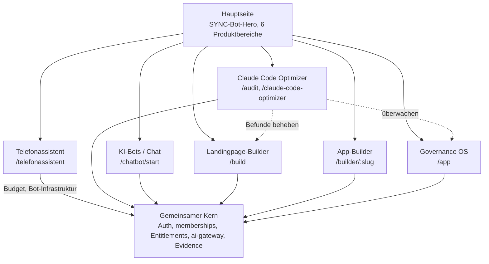
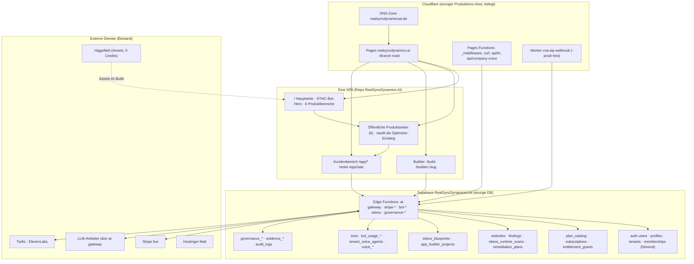

# Verbindliche Zielarchitektur: RealSync Dynamics & AI

**Stand:** 20.11.2026, nur lesend erhoben (Commit `76537ef` vom 18.11.2026).
**Art:** Doku-Entwurf zur Prüfung. Keine Code-, Config-, Migrations- oder Workflow-Änderung und kein Nachweis eines erreichten Betriebsstands.
**Canvas:** [Verbindliche Zielarchitektur: RealSync Dynamics & AI](https://cursor.com/canvas/store-9f9de6f1-d0ca-42dc-bf36-3b4cf9db6ffc/a6915974-7243-4a04-b29d-64c0d535fa9b)

Hauptseite als Dach mit sechs gleichberechtigten, einzeln und ohne Domain-Scan zugänglichen Produkten (Entscheidung Dominik, 20.11.2026); Planbare Kosten als gemeinsames Versprechen; am aktuellen Code und an den Live-Systemen geprüft. Jede Aussage ist als Belegt, Vorschlag, Offen oder Blockiert markiert.

**Quellen**

- Repo realsyncdynamics-spec/RealSyncDynamics.AI, main @ 76537ef (lokal geklont, nur gelesen)
- Supabase RealSyncDynamicsLive (Schema, Policies, Zählungen)
- Stripe live acct_1TYVIyREjTWueUcG (Produkte, Preise)
- Cloudflare Zone, Pages, Workers
- Netlify-Team (Projektliste)
- Vercel (Projektliste)
- Higgsfield (Workspace, Projekte, Website)
- Öffentliches DNS (dns.google), HTTP-Header
- Bewertungsportale G2, Capterra, Trustpilot, OMR Reviews, Gartner Peer Insights (abgerufen 20.11.2026)

> **Markierungen.** Belegt: am Code, an der Datenbank oder am Live-System nachgewiesen. Vorschlag: Architekturentscheidung zur Freigabe. Offen: fehlende Entscheidung oder nicht geprüft. Blockiert: hängt an Secret, Freigabe, Credits oder einem defekten Pfad.

| Kennzahl | Wert | Detail | Markierung |
|---|---|---|---|
| Produktions-Host | 1 | Cloudflare Pages (belegt) | Belegt |
| Route-Einträge | 539 | in `src/App.tsx` | — |
| RLS-Policies | 808 | 0 Tabellen ohne RLS in public | — |
| Policies memberships : tenant_memberships | 116 : 14 | memberships ist führend | — |
| Offene PRs | 57 | GitHub-Suche, 20.11.2026 | — |
| SYNC-Bot-Modelldateien | 0 | kein .glb/.gltf/.riv/.lottie | Blockiert |

## Inhalt

- [1 Bestandsbild](#1-bestandsbild)
- [2 Soll-Ist-Matrix](#2-soll-ist-matrix)
- [3 Zielarchitektur](#3-zielarchitektur)
- [4 Routenplan](#4-routenplan)
- [5 Daten- und Schnittstellenübersicht](#5-daten--und-schnittstellenübersicht)
- [6 Produktabläufe](#6-produktabläufe)
- [7 Abhängigkeiten und Blocker](#7-abhängigkeiten-und-blocker)
- [8 Priorisierte Umsetzungsreihenfolge](#8-priorisierte-umsetzungsreihenfolge)
- [9 Risiken und offene Entscheidungen](#9-risiken-und-offene-entscheidungen)
- [Freigabekriterium öffentliche Darstellung](#freigabekriterium-öffentliche-darstellung)
- [Marktanalyse (Zusammenfassung)](#marktanalyse-zusammenfassung)
- [Abschluss](#abschluss)
- [Quellenlage](#quellenlage)

## 1 Bestandsbild

> **Produktanzahl entschieden: 6 Produkte (erledigt).** Status: Belegt.
> Dominik hat verbindlich entschieden: (1) Persönlicher Telefonassistent für KMU, (2) KI-Bots / Chat-Assistent als eigenes Produkt, das Budget- und Verbrauchsmechanik sowie Bot-Infrastruktur mit dem Telefonassistenten teilt, (3) Landingpage-Builder, (4) App-Builder, (5) Governance OS, (6) Claude Code Optimizer (Website-Scan, Befunde, Fix-Vorschläge; einzeln buchbar und zugleich Einstieg im Kundenweg). Die frühere Abweichung zwischen vier und sechs Produkten ist damit aufgelöst.

### Frontend, Design und Assets

| Befund | Fundstelle | Status |
|---|---|---|
| Vite 6, React 19, react-router-dom 7, Tailwind 4; Puck-Editor; three 0.184, @react-three/fiber, drei; framer-motion und motion | `package.json` | Belegt |
| Startseite `/` ist LandingV3, helle Gestaltung (Tokens unter .lv3, Hintergrund #ffffff), seit 17.11.2026 | `src/pages/LandingV3.tsx`, `src/styles/landing-v3.css`, `src/product/implementation-status.ts` | Belegt |
| Hero-3D ist prozedural (vier Figuren je Produkt: Flächen, Kugel mit Schallringen, Knoten, Kern mit Ringen), lädt nur lazy; bei prefers-reduced-motion oder höchstens 4 Kernen bleibt das Standbild | `src/components/landing/v3/heroScene3D.ts`, `HeroStage.tsx`, `public/landing-v3/hero-still.jpg` | Belegt |
| Produktkarten heute: App Builder, KI-Bots & Voice Agenten, Claude Code Optimizer, Governance OS. Landingpage-Builder hat keine eigene Karte; heute 4 Produktfelder belegt, Zielbild 6 gleichberechtigte Produktbereiche | Live-Startseite, `landingV3Data.ts` | Belegt |
| Status-Badges dürfen nur aus der Registry kommen; Preise nur aus `shared/pricing.ts` | `AGENTS.md`, `implementation-status.ts` | Belegt |
| Widerspruch: AGENTS.md schreibt Hard-Edge-UI Obsidian/Titanium/Security-Blue vor, Landing v3 ist hell; offener Draft-PR #2354 will weißes Design verbindlich verankern | `AGENTS.md`, PR #2354 | Offen |
| 56 Dateien berücksichtigen prefers-reduced-motion | `src/` | Belegt |

### SYNC-Bot: vorhandene Assets

| Quelle | Fund | Status |
|---|---|---|
| Repo (ohne node_modules) | Keine .glb, .gltf, .riv, .lottie, .splinecode, .usdz, .fbx, .obj; keine Lottie-JSON; keine Komponente namens SyncBot. Nur Text in BotBuilderView: derselbe RealSync-Bot | Belegt |
| Repo `public/brand` | realsync-3d-mark.png (gerendertes 3D-Logo als Bild), avatar-400.png/.svg, logo-square-400 | Belegt |
| Higgsfield-Projekt | RealSync Hero – Empfangsroboter: 0 Assets | Belegt |
| Higgsfield-Website | realsync-neon.higgsfield.app, Titel RealSync KI-Empfang, dunkles Theme, Motiv gläserner KI-Mitarbeiter bzw. Würfel; ein OG-Bild (PNG) auf CloudFront; keine 3D- oder Animationsdatei im ausgelieferten HTML gefunden | Belegt |
| Higgsfield-Guthaben | Plan free, 0 Credits: keine Generierung möglich | Blockiert |

Fazit: Einen fertigen SYNC-Bot als Modell oder Animation gibt es nicht. Verwendbar sind das Higgsfield-Motiv (Bild), das 3D-Logo und die prozedurale three.js-Bühne. Status: Blockiert für ein echtes SYNC-Bot-Modell, bis Credits oder ein beauftragtes Modell vorliegen.

### Hosting und Routing: Netlify vs. Cloudflare

| Befund | Nachweis | Status |
|---|---|---|
| Live-Auslieferung von realsyncdynamicsai.de läuft über Cloudflare Pages-Projekt realsyncdynamics-ai (Git-Integration, Branch main, Build `npm run build`, Ausgabe `dist`) | DNS: Apex und www CNAME auf realsyncdynamics-ai.pages.dev, proxied; HTTP-Header server: cloudflare; Cloudflare-API | Belegt |
| Netlify-Projekt realsync-dynamics-ai-cd-566ec9b040 trägt realsyncdynamicsai.de als Primärdomain, bekommt aber keinen Verkehr (DNS zeigt nicht auf Netlify) | Netlify-Projektliste, DNS | Belegt |
| Netlify-Projekt unrivaled-lily-1a2970 trägt realsyncdynamics.de; diese Domain zeigt per DNS (Nameserver United Domains) auf GitHub-Pages-IPs 185.199.108–111.153 | Netlify, dns.google | Belegt |
| Weitere Netlify-Projekte: realsync-landing-fix-preview-2026-11-06, praxisbot-landing, praxis-boehm-vorschau, dominik-avatar-test, zwei Moon-Shop-Projekte | Netlify | Belegt |
| Repo hat kein `netlify.toml`; Cloudflare-Konfiguration in `wrangler.toml`, `public/_redirects` (301-Regeln), `public/_headers`, Pages Functions unter `functions/` | Repo | Belegt |
| Mehrere zusätzliche Deploy-Workflows (`deploy-frontend-vps*.yml`, `docker-deploy.yml`, `deploy.yml`) neben Cloudflare Pages | `.github/workflows` | Offen |
| Produktions-CSP erlaubt connect-src `http://localhost:11434` (lokales Ollama) und Werbe-/Analyse-Hosts (Facebook, TikTok, LinkedIn) | HTTP-Header content-security-policy | Belegt |

Empfehlung (Vorschlag): Cloudflare Pages bleibt einziger Produktions-Host. Die Netlify-Bindung von realsyncdynamicsai.de wird nach Freigabe entfernt, damit kein zweiter Auslieferungsweg und keine Zertifikatsverwirrung entsteht. Netlify-Projekte bleiben nur für Vorschauen oder werden archiviert.

### Auth, Mandanten und Rollen

| Befund | Zahlen | Status |
|---|---|---|
| memberships ist die aktiv genutzte Mitgliedschaftstabelle | 9 Zeilen; 116 RLS-Policies; 19 DB-Funktionen; 10 Referenzen in `src/`, 97 in `supabase/functions/` | Belegt |
| tenant_memberships ist Altbestand | 4 Zeilen; 14 Policies auf 8 Tabellen (`webhook_endpoints`, `custom_controls`, `custom_framework_mappings`, `api_rate_limit_configs`, `api_calls`, `email_notifications`, `quota_alerts`, `api_rate_limit_violations`); 2 DB-Funktionen; 0 Code-Referenzen | Belegt |
| Geschützte Routen unter `/app/*` laufen über AppGate (`src/features/auth/AppGate.tsx`) | Route-Analyse `App.tsx` | Belegt |
| Rollen in Migrationen vor allem owner und admin; Voice-Checkout nur für Owner/Admin des Mandanten | Migrationen, `_shared/voice-agent-checkout.ts` | Belegt |
| Mandant, Rechte und Einwilligung nie aus dem Request-Body; fail-closed bei Auth- oder Policy-Fehlern | `AGENTS.md` (Regel) | Belegt |
| 9 Mandanten, 8 Auth-Nutzer | SQL-Zählung | Belegt |

> **Empfehlung memberships vs. tenant_memberships.**
> memberships ist führend und bleibt die einzige Mitgliedschaftsquelle. tenant_memberships wird eingefroren: zuerst prüfen, ob die 4 Zeilen in memberships enthalten sind (Offen), dann die 14 Policies per additiver Migration auf memberships umstellen, mit isolierten RLS-Tests (`npm run test:db`) auf einer Branch-DB. Die Tabelle erst nach Abnahme und einem Beobachtungszeitraum zurückbauen oder als Kompatibilitäts-View führen. Keine dritte Tabelle.

### Backend, KI und Sprache

| Befund | Fundstelle | Status |
|---|---|---|
| Eine Supabase-DB, 425 Tabellen in public plus Schemata agentos, creatorseal, integration_memory; alle public-Tabellen mit RLS | Supabase | Belegt |
| 206 Ordner in `supabase/functions` (inkl. `_shared`); Projektregel nennt ein Limit von 200 Funktionen | Repo, implementation-status (creative-studio) | Belegt |
| 433 Migrationen; Regel: nur additiv | `supabase/migrations`, `MONOREPO.md` | Belegt |
| ai-gateway (Registry: live) mit Anbieterpfaden für OpenAI, Anthropic, Ollama, Google/Gemini, Mistral, xAI; Zeitlimit per `AI_GATEWAY_PDP_TIMEOUT_MS` | `supabase/functions/ai-gateway` | Belegt |
| KI-Budget: Reservierung und Abrechnung je Mandant; fehlende Mandantenkonfiguration erlaubt keine kostenpflichtige Nutzung | `_shared/bot-budget.ts`, Migration `bot_usage_budget_hardening` (laut `docs/ARCHITECTURE_CURRENT.md`) | Belegt |
| Telefonie: Twilio-Webhook (`bot-voice-webhook`, Signaturprüfung), ElevenLabs-Bereitstellung (`provision-voice-agent`), Cloudflare-Worker `vva-sip-webhook` | `supabase/functions`, Cloudflare | Belegt |
| Telefonie nicht live: kein Deploy-Pfad für `apps/agent-runtime` (letzter Lauf 06.10.2026 fehlgeschlagen), keine angebundene Rufnummer | implementation-status voice-telephony; `voice_number_bindings` 0 Zeilen | Blockiert |
| Kalender-Integration für Terminwünsche: in den Edge Functions nicht gefunden | grep `supabase/functions` | Offen |

### Zahlungen: Fluss vom Produktaufruf bis Success-Redirect

1. **`/pricing` → `/checkout/:planKey` (Belegt).** CheckoutPage liest den Plan aus der SSoT. Free Audit leitet auf `/audit`, Enterprise-Anfrage auf `/contact-sales`.
2. **Beta-Weiche (Belegt).** Starter, Growth und Agency gehen während der offenen Beta nicht zu Stripe, sondern auf die Beta-Anmeldung (`config/beta.ts`, `betaSignupHref`). beta-enroll gibt serverseitig Growth-Umfang bis 31.01.2027.
3. **Stripe Checkout (Belegt).** Übrige Pläne: Edge Function `stripe-checkout` erzeugt eine Hosted-Checkout-Session; success_url `/checkout/success?session_id=…&plan_key=…`, Abbruch `/checkout/cancelled`.
4. **Bestätigung (Belegt).** `/checkout/success` ruft `stripe-checkout-verify`; `stripe-webhook` schreibt `subscriptions`, `entitlement_grants`, `stripe_invoices`.
5. **Voice-Abo (Blockiert).** `/voice/checkout/:offerId` → `checkout-voice-agent` (Schalter `VOICE_CHECKOUT_ENABLED`, Owner/Admin, Preisabgleich mit SSoT) → zurück auf `/voice/checkout/:id?checkout=success`. Die VVA-Produkte sind in Stripe inaktiv.
6. **Builder-Käufe (Belegt).** `checkout-siteos-project` → `/app/siteos?checkout=success`; `checkout-website-rebuild` mit eigenem Erfolgs-Pfad.
7. **Nachweis (Offen).** Ein vollständiger Live-Neukauf inklusive Zahlung, Webhook, Provisionierung und Entitlement ist laut Registry (17.11.2026) nicht nachgewiesen. Datenbank: 9 subscriptions, 18 `stripe_payment_events`.

### Tests, Build und laufende Arbeit

| Befund | Status |
|---|---|
| Build: `build:base` (Vite + Legal-Pages) und Prerender; Tests: vitest, Playwright (`e2e/`, `tests/e2e`), `test:db`; viele Drift-Checks (`check:spa-routes`, `check:pricing`, `check:entitlements`, `check:function-acls`, `check:sitemap`) | Belegt |
| 44 GitHub-Workflows, u. a. ci, e2e, codeql, migration-drift, entitlement-drift, edge-function-drift, lighthouse-ci | Belegt |
| 57 offene PRs; die neuesten acht sind Drafts vom 20.11.2026: DSR-Evidence-Outbox (#2362–#2364), Automation-Runner (#2355, #2356), Status-Vertrag (#2359), Voice-API-Routing und Pages-Functions-CI (#2358), weißes Design (#2354) | Belegt |
| Liste der übrigen 49 offenen PRs nicht vollständig gelesen (Antwort gekürzt) | Offen |
| Neueste Cloudflare-Deployments: Previews des Branches `feat/phase3-dsr-evidence-outbox`, Status deploy:success | Belegt |

## 2 Soll-Ist-Matrix

| Bereich | Soll (Briefing) | Ist (belegt) | Lücke | Status |
|---|---|---|---|---|
| Hauptseite | Dach, SYNC-Bot als Hero, sechs gleichberechtigte Produktbereiche, hell und redaktionell | LandingV3 hell, 3D-Bühne mit vier Figuren, vier Karten: App Builder / KI-Bots & Voice / Optimizer / Governance OS | Kein SYNC-Bot-Modell; heute 4 Produktfelder belegt; Erweiterung auf 6 (Telefonassistent und Chat getrennt, Landingpage-Builder neu, 3D-Bühne um zwei Figuren) ist Vorschlag | Offen |
| 1 Persönlicher Telefonassistent | Natürlich klingender Telefonassistent für KMU | Voice-Onboarding Preview; Telefonie Coming Soon; Twilio-/ElevenLabs-Code und `vva-sip-webhook` vorhanden | Deploy-Pfad, Rufnummer, Kalender, aktive Stripe-Produkte, Sprachtest vor Anbieterwahl | Blockiert |
| 2 KI-Bots / Chat-Assistent | Eigenes Produkt; teilt Budget-/Verbrauchsmechanik und Bot-Infrastruktur mit dem Telefonassistenten | Chat-, WhatsApp-, Telegram-Bots Preview (`/chatbot/start`, `/app/bots`); bots (2); `bot_usage_*` mit Reservierung und Ledger | Kein eigenes Preisobjekt (nur Plan-Entitlements und Add-ons WhatsApp 99 €, Response Pack 49 €); Provider-Laufzeit Preview | Offen |
| 3 Landingpage-Builder | Geführtes Onboarding, Live-Vorschau, Motion, optional 3D | `/build` Studio (Preview), `siteos_blueprints` versioniert (14), Publish-Gate mit Owner/Admin-GO | Eigene Domain, DNS, Rollback fehlen; geführtes Onboarding mit Motion/3D nur als Notion-Konzept; Repo `landingpage-3d-builder` separat | Offen |
| 4 App-Builder | Idee, Anforderungen, Vorschau, funktionsfähige App | `/builder/:slug` und `/builder/:slug/code` (bolt.diy-Protokoll), `app_builder_projects` (0 Zeilen), WebContainer und Deploys deaktiviert | Auslieferung einer laufenden App fehlt; kein Preis | Blockiert |
| 5 Governance OS | KI-Nutzung und Prüfungen nachvollziehbar verwalten und überwachen | App-Shell, Command Center, KI-Register, AI-Act-Klassifizierung, Evidence, Policy Engine live; Monitoring Coming Soon | Dauerhafte Domain-Überwachung (Cron-Secret), Inventar-Persistenz Preview | Offen |
| 6 Claude Code Optimizer | Website-Scan, Befunde, Fix-Vorschläge; einzeln buchbar und Einstieg im Kundenweg | `/audit` live; `/claude-code-optimizer` Preview; `/optimizer/checkout` übergibt an die Plattformpläne (`/checkout/:planKey`); findings, `remediation_plans`; keine produktive Code-Korrektur | Kein eigenes Preisobjekt für Einzelbuchung; zwei Routenbäume | Offen |

## 3 Zielarchitektur

| Schicht | Verbindliche Festlegung | Status |
|---|---|---|
| Frontend | Eine SPA im Monorepo. Drei Zonen: öffentlich (Hauptseite, sechs Produktseiten, `/audit`, `/pricing`), Builder (`/build`, `/builder/:slug`), Kundenbereich (`/app/*` hinter AppGate). Produktstatus nur aus `implementation-status.ts` | Vorschlag |
| Gestaltung | Helle RealSync-Gestaltung der LandingV3 bleibt; SYNC-Bot als Hero-Motiv mit Standbild-Fallback; 3D/Motion nur lazy, mobil und bei reduzierter Bewegung als Standbild (vorhandenes Muster in HeroStage) | Vorschlag |
| Backend | Edge Functions sind die einzige serverseitige Logik für Produktaktionen; neue Funktionen nur, wenn das 200er-Limit es erlaubt, sonst bestehende erweitern | Vorschlag |
| Daten | Eine DB; jede Tabelle mit `tenant_id` und RLS über memberships; Versionierung append-only (Muster `siteos_blueprints`, `app_builder_projects`) | Vorschlag |
| Auth | Supabase Auth, Einstieg `/welcome`, Mandantenbindung über memberships; `tenant_memberships` wird abgelöst | Vorschlag |
| KI | Alle Modellaufrufe über ai-gateway mit Budget-Guard; Anbieterwechsel per Konfiguration; Zeitlimit und fail-closed; Secrets nur in Edge-Env oder Vault, nie `VITE_*` | Vorschlag |
| Sprache | Ein Voice-Pfad: Twilio/SIP-Eingang → Edge Function → ElevenLabs-Agent, Bindung über `voice_number_bindings`; Vercel- und Worker-Stränge werden darauf konsolidiert | Vorschlag |
| Zahlungen | Ein Stripe-Account, Preise nur aus `shared/pricing.ts`, Freischaltung nur über `stripe-webhook` in `entitlement_grants`/`subscriptions`; nichts als buchbar zeigen ohne nachgewiesenen Checkout | Vorschlag |
| Hosting | Cloudflare Pages (Frontend + Pages Functions), Supabase (DB, Edge), Cloudflare Worker (SIP), Hostinger nur Mail | Vorschlag |
| Betrieb | Sentry, Drift-Checks und Cron-Health bestehen; Kill-Switch und Budget-Grenzen je Mandant | Vorschlag |

Gleichwertige Darstellung des Knotendiagramms (Richtung vertikal):



### Planbare Kosten: gemeinsames Versprechen aller sechs Produkte

Versprechen (Vorgabe Dominik): Bevor der Kunde eine kostenpflichtige Aktion bestätigt, sieht er, was sie kostet oder welchen Höchstbetrag er freigibt. Danach kann er nachvollziehen, wofür sein Budget verwendet wurde. Die folgende Architektur ist ein Vorschlag und baut auf vorhandenen Bausteinen auf, ohne neue Parallelstrukturen.

| Baustein | Bestand | Lücke / Vorschlag | Status |
|---|---|---|---|
| Zentrale Preisquelle (Verkauf) | `shared/pricing.ts`: PLANS, ADDONS, BOOKABLE_MODULES (`MODULE_PRICING_STATUS` = provisional); `check:pricing`, `check:offer-prices`, stripe-price-guard-Test | `plan_catalog` in der DB weicht ab (`governance_launch` 0 € statt 349 €); Voice hat drei Preise (siehe unten) | Belegt |
| Einkaufspreise KI | `shared/model-prices.ts` mit Deno-Zwilling, `check:model-prices` | Für Telefonie fehlen gemessene Minuten- und STT/TTS-Kosten (Kommentar in `pricing.ts`) | Belegt |
| Angebot / Höchstbetrag vor Bestätigung | Kein Kunden-Angebotsschritt gefunden | Ein Angebotsschritt in bestehenden Edge Functions: Betrag oder Höchstbetrag aus `pricing.ts` + `model-prices.ts`, Angebots-ID, Gültigkeit | Vorschlag |
| Budget / Reservierung | `bot_usage_reservations` (open → settled \| released), `bot_usage_reserve` mit `pg_advisory_xact_lock` je Mandant und Ressource, Tages- und Monatslimit führen zu deny | Nur für Bot-Kanäle. Dieselben Funktionen mit weiteren resource-Werten (z. B. `app_build`, `lp_publish`, `monitoring`) nutzen statt neuer Tabellen | Belegt |
| Verbrauchsledger | `bot_usage_ledger` append-only, origin measured / estimated / corrected; laut Tabellenkommentar nicht Stripe-Billing | Read-only Kundenansicht je Mandant (View) mit Aktion, Angebots-ID, reserviert, tatsächlich | Belegt |
| Idempotenz | UNIQUE (`resource`, `provider`, `external_ref`) auf Reservierungen; eine Abrechnung je Reservierung; `event_key` unique im Ledger; `stripe-webhook` mit Idempotenz-Speicher; `stripe-checkout` mit `idempotencyKey` für Kunden | Angebots-ID als `external_ref`, damit ein technischer Retry den bestehenden Eintrag zurückgibt (Funktion liefert dann existing); für Builder-Käufe nicht nachgewiesen | Belegt |
| Freischaltung laufender Kosten | `stripe-webhook` schreibt `subscriptions` und `entitlement_grants` | Laufende Überwachung nur über eigene, ausdrücklich bestätigte Buchung, nie als Nebenwirkung eines Scans | Vorschlag |

1. **Preis ermitteln (Vorschlag).** Aus `shared/pricing.ts` bzw. `model-prices.ts`; kein Preis im Frontend hart codiert.
2. **Anzeigen und bestätigen lassen (Vorschlag).** Betrag oder Höchstbetrag, enthaltenes Kontingent, Verhalten am Limit.
3. **Reservieren (Bestand für Bots, Vorschlag für alle).** `bot_usage_reserve` unter Mandanten-Lock; Überschreitung führt zu deny, fail-closed.
4. **Ausführen und abrechnen (Bestand für Bots).** Abrechnung als measured; unklarer Verbrauch zum reservierten Höchstbetrag als estimated, später corrected.
5. **Nachvollziehen (Vorschlag).** Kundenansicht aus dem Ledger, verknüpft mit Gesprächs-, Build- oder Scan-Protokoll.

### Mermaid-Quelle (für docs/ im Repo)



## 4 Routenplan

| Route | Zweck | Zugang | Ziel / Komponente | Status |
|---|---|---|---|---|
| `/` | Hauptseite | öffentlich | LandingV3 | Belegt |
| `/telefonassistent` | Produktseite Persönlicher Telefonassistent | öffentlich | neu; CTA auf Voice-Onboarding bzw. `/warteliste`, solange Telefonie Coming Soon | Vorschlag |
| `/ki-bots` | Produktseite KI-Bots / Chat-Assistent | öffentlich | neu; CTA auf `/chatbot/start` | Vorschlag |
| `/landingpage-builder` | Produktseite Landingpage-Builder | öffentlich | neu; CTA auf `/build` | Vorschlag |
| `/app-builder` | Produktseite App-Builder | öffentlich | neu; CTA auf `/build` bzw. `/builder/:slug` | Vorschlag |
| `/governance-os` | Produktseite Governance OS | öffentlich | neu; heute nur `/governance-os-pricing`, `/runtime` | Vorschlag |
| `/audit` | Website prüfen (kostenloser Scan) | öffentlich, ohne Konto | AuditLanding; `/domain-check`, `/domain-checker`, `/dsgvo-website` 301 | Belegt |
| `/claude-code-optimizer` (+`/scan`, `/ergebnis`, `/anmelden`, `/bericht`) | Produktseite und Ablauf Claude Code Optimizer | öffentlich, Bericht nach Anmeldung | Optimizer-Seiten; Einzelbuchung fehlt | Belegt |
| `/optimizer/*` | Zweiter Routenbaum für den Optimizer | öffentlich | Vorschlag: 301 auf `/claude-code-optimizer` | Offen |
| `/chatbot/start` | Chat-Assistent ausprobieren | öffentlich | Bot-Start (Preview) | Belegt |
| `/unternehmen`, `voice.realsyncdynamicsai.de/onboarding.html` | Voice-Onboarding | öffentlich | GitHub Pages (Preview) | Belegt |
| `/build` | Builder-Studio | Konto, plan-gated (`siteos.builder`) | BuildStudioPage; `/website-builder` 301 | Belegt |
| `/builder/:slug`, `/builder/:slug/code` | App-Builder-Arbeitsbereich | Konto | AppBuilderWorkspacePage, BoltCodeBuilderPage | Belegt |
| `/pricing`, `/pricing/:slug`, `/pricing/whatsapp` | Preise | öffentlich | PricingPage; `/preise` 301 | Belegt |
| `/checkout/:planKey`, `/checkout/success`, `/checkout/cancelled` | Kauf | öffentlich → Stripe | CheckoutPage, CheckoutSuccess; `/checkout` 301 auf `/pricing` | Belegt |
| `/voice/checkout/:offerId` | Voice-Abo | Owner/Admin | VoiceCheckoutPage | Blockiert |
| `/welcome`, `/login`, `/logout` | Anmeldung | öffentlich | Welcome, LoginPage, LogoutPage; `/signup`, `/register` u. a. 301 | Belegt |
| `/app/dashboard` | Kundenbereich Start | AppGate | Command Center; `/dashboard`, `/assistant` 301 | Belegt |
| `/app/bots`, `/app/bots/:botId`, `/app/bots/inbox`, `/app/bots/whatsapp` | Bots verwalten | AppGate | Bot-Builder, Posteingang | Belegt |
| `/app/voice`, `/app/voice/:sessionId` | Voice-Sessions | AppGate | read-only Liste, Leerzustand | Belegt |
| `/app/siteos`, `/app/siteos/builder`, `/app/siteos/modernize` | Website-Projekte | AppGate, teils Enterprise | SiteOS-Ansichten | Belegt |
| `/app/websites` | Domains des Kunden | AppGate | DomainManager (Preview) | Belegt |
| `/app/governance/*`, `/app/evidence-vault`, `/app/scheduler` | Governance OS | AppGate | Governance-Module | Belegt |
| `/app/billing` | Abo und Rechnungen | AppGate | Stripe-Portal; `/billing` 301 | Belegt |
| `*` | Unbekannte Seite | öffentlich | NotFoundPage (echter 404 nötig, Prerender-Fallback prüfen) | Belegt |
| Nicht verfügbare Funktion | Coming-Soon-Zustand | je Route | Badge und Text nur aus implementation-status, kein Schein-CTA | Vorschlag |

| Produkt | Einstieg ohne Domain-Scan | Heutiger Stand | Status |
|---|---|---|---|
| Telefonassistent | `/telefonassistent` → Voice-Onboarding | `voice.realsyncdynamicsai.de/onboarding.html` ohne Domain-Scan erreichbar; Telefonie selbst Coming Soon | Belegt |
| KI-Bots / Chat | `/ki-bots` → `/chatbot/start` | `/chatbot/start` ist öffentlich und ohne Domain erreichbar | Belegt |
| Landingpage-Builder | `/landingpage-builder` → Entwurf ohne Domain | Anonyme Entwürfe vorhanden (`siteos_anonymous_builds`); `/build` selbst ist plan-gated, Einstieg ohne Konto und Domain nicht end-to-end geprüft | Offen |
| App-Builder | `/app-builder` → `/builder/:slug` | Arbeitsbereich braucht Konto, keine Domain | Belegt |
| Governance OS | `/governance-os` → Konto → `/app` | Heute führen die öffentlichen CTAs vor allem auf `/audit` (Scan); Einstieg ohne Scan nicht als eigener Weg vorhanden | Offen |
| Claude Code Optimizer | `/claude-code-optimizer` bzw. `/audit` | Der Scan ist hier das Produkt selbst; ohne Konto startbar | Belegt |
| Regel | Der Optimizer-Scan ist Einstiegsangebot, keine Pflichtstufe vor den anderen fünf Produkten | – | Vorschlag |

## 5 Daten- und Schnittstellenübersicht

| Ebene | Tabellen (Zeilen) | Zweck | Status |
|---|---|---|---|
| Nutzer | `auth.users` (8), `profiles` | Identität, Onboarding-Status | Belegt |
| Betrieb (Mandant) | `tenants` (9), `memberships` (9), `company_profiles`, `tenant_onboarding` | Mandant, Rollen, Branche | Belegt |
| Projekt | `websites` (2), `siteos_blueprints` (14), `app_builder_projects` (0), `fmt_projects` | Domains, Landingpages, Apps | Belegt |
| Produkt / Recht | `plan_catalog`, `subscriptions` (9), `entitlement_grants`, `subscription_addons` | Was der Mandant nutzen darf | Belegt |
| Gemeinsame Bot-Infrastruktur | `bots` (2), `bot_usage_limits`/`_reservations`/`_ledger` | Konfiguration und Budget für Telefonassistent und Chat (eine Mechanik, getrennte resource-Werte) | Belegt |
| Telefonassistent | `tenant_voice_agents` (0), `voice_number_bindings` (0), `voice_sessions`, `voice_tool_requests`, `voice_executions`, `voice_evidence` | Telefonie, Read-back, Nachweis | Belegt |
| KI-Bots / Chat | `bot_conversations`, `bot_appointments` (laut Migrationen), Kanal-Webhooks | Konversationen, Terminwünsche | Belegt |
| Claude Code Optimizer | `siteos_runtime_scans`, `findings` (6), `siteos_scores`, `remediation_plans` | Website prüfen, Fix-Vorschläge | Belegt |
| Governance | `governance_*`, `ai_systems`, `ai_act_*`, `evidence_items`, `audit_logs` | Register, Freigaben, Nachweise | Belegt |
| Nachvollziehbarkeit | `audit_logs` (unveränderlich), `lead_erasure_log` (Art. 17), `pii_redaction_log`, `agent_actions_log` | Änderungen, Exporte, Löschungen | Belegt |

| Nicht speichern | Begründung | Status |
|---|---|---|
| Hoster-Passwörter von Kunden | Zugriff nur über verifizierte DNS-Einträge, Snippet oder gescopte Tokens im Vault | Vorschlag |
| Roh-HTML gescannter Seiten | `siteos_rebuild_runs` speichert laut Tabellenkommentar Snapshot ohne HTML | Belegt |
| Anrufaufzeichnungen ohne Einwilligung | Nur Transkript-Ausschnitte mit Einwilligung; Aufbewahrung festlegen | Offen |
| Secrets im Browser | Nur `VITE_SUPABASE_URL` und Anon-Key öffentlich | Belegt |

| Schnittstelle | Rolle | Status |
|---|---|---|
| `ai-gateway`, `ai-invoke` | Einheitlicher Modellzugang, Protokoll, Kosten | Belegt |
| `bot-chat`, `whatsapp-webhook`, `telegram-webhook` | Chat-Kanäle | Belegt |
| `bot-voice-webhook`, `bot-voice-enforcer`, `provision-voice-agent` | Telefonie, Policy, ElevenLabs-Bereitstellung | Belegt |
| `siteos`, `checkout-siteos-project` | Builder, Veröffentlichung, Kauf | Belegt |
| `cookie-scan`, `gdpr-audit`, `audit-recheck-weekly` | Website prüfen und erneut prüfen | Belegt |
| `governance-approvals` | Freigaben mit Nachweis | Belegt |
| `stripe-checkout`, `stripe-checkout-verify`, `stripe-webhook`, `stripe-portal`, `checkout-voice-agent` | Zahlungen | Belegt |
| Pages Functions `functions/api/fn/[[name]]`, `api/company-voice` | Edge-Proxy und Voice-API am Frontend-Host | Belegt |

## 6 Produktabläufe

### Landingpage-Builder

| Schritt | Existiert | Muss gebaut werden | Status |
|---|---|---|---|
| Eingabe / Onboarding | Anonyme Entwürfe vor Registrierung (`siteos_anonymous_builds`), Scan-Übergabe (`scanHandoff.ts`) | Geführtes Onboarding mit Branche, Stil, Motion- und 3D-Option (Design-DNA-Konzept) | Offen |
| Verarbeitung / Vorschau | Studio `/build` mit Puck-Editor, Live-Vorschau | Motion- und 3D-Bausteine als Blueprint-Komponenten mit Reduced-Motion-Fallback | Vorschlag |
| Speichern / Versionieren | `siteos_blueprints` append-only, `prev_hash`-Kette | – | Belegt |
| Übergabe | Publish-Gate (`siteos_publish_evaluations`) → Cloudflare-Vorschau → Produktion nur mit Owner/Admin-GO | Eigene Domain, DNS, Rollback | Offen |
| Grenzen | Repo `landingpage-3d-builder` lebt getrennt | Übernehmen oder archivieren, keine zweite Persistenz | Offen |

### App-Builder

| Schritt | Existiert | Muss gebaut werden | Status |
|---|---|---|---|
| Idee / Anforderungen | AppBuilderWorkspacePage mit Chat-Verlauf (`messages` in `app_builder_projects`) | Strukturierte Anforderungsliste mit Freigabe | Vorschlag |
| Vorschau | bolt.diy-Protokoll nachgebaut (Dateibaum, Aktionen), Governance je Aktion | Sichere Vorschau-Laufzeit (WebContainer bewusst deaktiviert) | Blockiert |
| Speichern / Wiederaufnehmen | `app_builder_projects` append-only mit merkle/`prev_hash`, Schreiben nur über `siteos/code-persist` | – | Belegt |
| Funktionsfähige App | `platform/builder_orchestrator` (Python) mit Governance-Gate | Hosting-Ziel und Deploy-Pfad; heute deaktiviert | Blockiert |

### Persönlicher Telefonassistent

| Anforderung | Stand | Status |
|---|---|---|
| Konfiguration | Bot-Builder `/app/bots`, Voice-Onboarding auf `voice.realsyncdynamicsai.de` | Belegt |
| Freigabe vor Einsatz | `governance-approvals` vorhanden; Kopplung an Bot-Livegang nicht nachgewiesen | Offen |
| Testmodus vs. produktive Telefonie | Worker `vva-sip-webhook-test` und `-prod` existieren; produktive Telefonie Coming Soon | Blockiert |
| Offenlegung, dass eine KI spricht | Auf der Higgsfield-Seite versprochen; im Voice-Code nicht nachgewiesen | Offen |
| Einwilligung und Protokollierung | `voice_evidence` (Hash-Kette), `voice_sessions` mit Provider-/Policy-Snapshot | Belegt |
| Übergabe an Menschen | Geplanter Ablauf auf der Startseite; Workflow nicht nachgewiesen | Offen |
| Schreibende Aktionen nur mit Berechtigung und bestätigtem Ergebnis | `voice_tool_requests` mit Policy-Entscheidung; `voice_executions` mit Read-back, nur confirmed erlaubt eine Zusage | Belegt |
| Kalender | Keine Integration in Edge Functions gefunden | Offen |

### Governance OS

| Fähigkeit | Stand | Status |
|---|---|---|
| KI-Register, AI-Act-Klassifizierung, DSGVO- und Tracking-Audit, Evidence-Export, Policy Engine, Herkunftsnachweis | Registry: live | Belegt |
| Freigaben mit Verantwortlichen | `governance_approvals`, `governance_assignments` | Belegt |
| Wiedervorlagen / Überwachung | `scan_schedules`, `audit-recheck-weekly` vorhanden; dauerhafte Überwachung wartet auf Cron-Secret | Blockiert |
| Trennung Software vs. Rechtsberatung | Preisseite: kein Ersatz für Rechtsberatung, kein 100 % rechtssicher | Belegt |
| Keine pauschalen Konformitätsaussagen | Regel in `AGENTS.md` (Claims); im Produkttext beibehalten | Vorschlag |

### KI-Bots / Chat-Assistent

| Schritt | Stand | Status |
|---|---|---|
| Ausprobieren ohne Konto | `/chatbot/start` | Belegt |
| Konfiguration und Kanäle | `/app/bots`, `/app/bots/whatsapp`, Telegram-Webhook; Provider-Laufzeit Preview | Belegt |
| Budget | Dieselbe Reservierung und dasselbe Ledger wie der Telefonassistent (`bot_usage_*`), Kanal-Limits je Plan (z. B. 500 WhatsApp-Konversationen im Add-on) | Belegt |
| Übergabe an Menschen | Posteingang `/app/bots/inbox` vorhanden; Regel für Übergabe am Limit nicht nachgewiesen | Offen |
| KI-Hinweis im Chat | Nicht geprüft | Offen |
| Eigenständige Buchung | Kein eigenes Preisobjekt; heute über Plan-Entitlements und Add-ons | Offen |

### Claude Code Optimizer

| Schritt | Stand | Status |
|---|---|---|
| Scan ohne Konto | `/audit` und `/claude-code-optimizer/scan` | Belegt |
| Befunde | `findings`, `siteos_runtime_scans`, `siteos_scores`; Bericht nach Anmeldung (`/claude-code-optimizer/bericht`) | Belegt |
| Fix-Vorschläge | `remediation_plans`; keine bestätigte produktive Code-Korrektur | Belegt |
| Übergabe an andere Produkte | Scan-Übergabe an den Builder (`scanHandoff.ts`); Überwachung über Governance OS | Belegt |
| Einzelbuchung | `/optimizer/checkout` leitet auf Plattformpläne; kein eigener Preis in `shared/pricing.ts` | Offen |
| Zwei Routenbäume | `/optimizer/*` und `/claude-code-optimizer` zusammenführen | Vorschlag |

### Monetarisierung je Produkt

| Produkt | Kostenlos | Bezahlt laufend | Einrichtung | Status |
|---|---|---|---|---|
| Governance OS | Free Audit | Starter 79, Growth 249, Agency 699, Enterprise 1.498 €/Monat (Stripe aktiv); bis 31.01.2027 Beta statt Checkout | Governance Launch 349 € (Stripe) vs. 0 € im `plan_catalog` | Offen |
| Telefonassistent | – | Drei Preise: VVA 89/199/349 € (Stripe, Produkte inaktiv), Add-on Voice 150 € + 0,25 €/Min, Modul 99 € | nicht entschieden | Blockiert |
| KI-Bots / Chat | Chat ausprobieren | Über Plan-Entitlements; Add-ons WhatsApp 99 €, Response Pack 49 €; kein eigenes Produkt | – | Offen |
| Landingpage-Builder | Anonymer Entwurf | kein Stripe-Produkt; Builder über Plan-Entitlements | Website-Rebuild nur interne Zeilen | Offen |
| App-Builder | – | kein Preis | – | Offen |
| Claude Code Optimizer | Scan ohne Konto | Heute nur über Plattformpläne; Einzelbuchung (Bericht, Fix-Vorschläge) ohne Preisobjekt | – | Offen |

Regel (Vorschlag): Ein Produkt wird erst als buchbar angezeigt, wenn ein vollständiger Testkauf bis zum Entitlement nachgewiesen ist. Bis dahin Warteliste, kein Schein-Checkout.

## 7 Abhängigkeiten und Blocker

| Produkt | Supabase | Cloudflare | Stripe | Extern | Repo |
|---|---|---|---|---|---|
| Hauptseite | – | Pages | Preise aus SSoT | Higgsfield (Hero-Asset) | LandingV3, `landingV3Data.ts` |
| Telefonassistent | `bot_usage_*`, `voice_*` | Worker `vva-sip-webhook` | VVA-Produkte, Voice-Add-on | Twilio, ElevenLabs, LLM | Monorepo; `realsync-voice`, `vertical-voice-agent` (Satelliten) |
| KI-Bots / Chat | `bots`, `bot_usage_*`, `bot_conversations` | Pages | Plan-Entitlements, WhatsApp-Add-on | WhatsApp Business, Telegram, LLM | Monorepo |
| Landingpage-Builder | `siteos_blueprints`, `websites` | Pages, Custom Hostnames | fehlt | Higgsfield | Monorepo; `landingpage-3d-builder` |
| App-Builder | `app_builder_projects` | Vorschau-Host fehlt | fehlt | LLM | Monorepo `src/features/app-builder`, `platform/` |
| Governance OS | `governance_*`, `evidence_*` | Pages | Pläne aktiv | – | Monorepo |
| Claude Code Optimizer | `findings`, `siteos_runtime_scans`, `remediation_plans` | Pages | Plattformpläne; eigenes Preisobjekt fehlt | Playwright-Scanner, LLM | `services/playwright-scanner`, `src/pages/claude-code-optimizer` |

| Blocker | Detail | Status |
|---|---|---|
| Stripe-Livekauf nicht nachgewiesen | `stripe-checkout-e2e` Preview; Secrets-Doku (`PRODUCTION_BLOCKERS.md`, Stand 04.08.2026) nennt fehlende `STRIPE_SECRET_KEY`/`RESEND_API_KEY`, heutiger Stand ungeprüft | Blockiert |
| Telefonie ohne Deploy und Rufnummer | agent-runtime-Deploy fehlgeschlagen; `voice_number_bindings` leer; VVA-Produkte inaktiv | Blockiert |
| Chat und Optimizer ohne eigenes Preisobjekt | Beide sollen einzeln buchbar sein; heute nur über Plattformpläne bzw. Add-ons | Offen |
| Dauerhafte Überwachung | Cron-Secret ausstehend | Blockiert |
| SYNC-Bot-Asset | Kein Modell, Higgsfield 0 Credits | Blockiert |
| App-Auslieferung | WebContainer und Deploys im App-Builder bewusst deaktiviert | Blockiert |
| Laufende Drafts | #2358 (Voice-Routing) und #2354 (Design) zuerst abwarten, sonst Doppelarbeit | Offen |
| Function-Limit | 206 Funktionsordner im Repo bei Limit 200: neue Produktlogik in bestehende Funktionen | Belegt |

## 8 Priorisierte Umsetzungsreihenfolge

| # | Arbeitspaket | Abnahmekriterium | Rollback | Status |
|---|---|---|---|---|
| AP0 | Produktanzahl entscheiden | Erledigt: 6 Produkte, Entscheidung Dominik vom 20.11.2026 | – | Belegt |
| AP0b | PR5- und PR6-Kostenregeln und Abnahmefälle bestätigen | Erledigt: von Dominik am 20.11.2026 bestätigt | – | Belegt |
| AP1 | Zielarchitektur als Doku-Draft-PR in `docs/architecture` (ohne Produktionswirkung) | PR-Review, keine Codeänderung | PR schließen | Vorschlag |
| AP2 | memberships-Konsolidierung: Abgleich der 4 `tenant_memberships`-Zeilen, additive Migration für 14 Policies | 0 Policies referenzieren `tenant_memberships`; RLS-Tests grün auf Branch-DB; Regression `check:function-acls` | Gespeicherte alte Policy-Definitionen wieder einspielen | Vorschlag |
| AP3 | Hosting-Hygiene: Netlify-Domainbindung von realsyncdynamicsai.de entfernen (Freigabe nötig), Deploy-Workflows inventarisieren | `smoke:production` und `diagnose:domain` grün; Netlify ohne Custom Domain | Domain in Netlify wieder eintragen | Vorschlag |
| AP4 | Hauptseite: sechs gleichberechtigte Produktbereiche (Telefonassistent, KI-Bots / Chat, Landingpage-Builder, App-Builder, Governance OS, Claude Code Optimizer als Produkt und Einstieg); 3D-Bühne um zwei Figuren erweitern; nach #2354 | `test/landing/landing-v3.test.tsx` angepasst und grün; Status nur aus Registry; `check:spa-routes` | Git-Revert, Pages-Rollback auf vorheriges Deployment | Vorschlag |
| AP5 | Sechs Produktseiten (fünf neue Routen: `/telefonassistent`, `/ki-bots`, `/landingpage-builder`, `/app-builder`, `/governance-os`; Optimizer vorhanden), Sitemap, 301 `/optimizer/*` → `/claude-code-optimizer` | `check:sitemap`, `check:spa-routes`, Playwright-Routen-Test | Revert; `_redirects`-Zeilen entfernen | Vorschlag |
| AP6 | SYNC-Bot-Hero: Asset-Brief, dann Modell oder Higgsfield-Animation; Fallback prozedurale Figur + Standbild | Lighthouse-Budget eingehalten; Standbild bei reduced-motion und schwachen Geräten; mobil geprüft | Feature-Flag aus, bisherige 3D-Bühne | Blockiert |
| AP7 | Stripe-Testkauf eines Plans im Testmodus bis Entitlement | Session → Webhook → `entitlement_grants` im Testmodus belegt | Testdaten bleiben im Testmodus | Vorschlag |
| AP7b | Deutscher Sprachtest vor der Anbieterwahl (Protokoll unten); nicht ausgeführt | Alle Kandidaten mit identischem Anruf getestet, Auswertungstabelle vollständig, Entscheidung nach Kosten je erfolgreichem Kundenkontakt | Keine Anbieterbindung vor Abschluss | Vorschlag |
| AP8 | Voice-Pfad vereinheitlichen nach #2358 und nach AP7b; VVA-Produkte erst nach Freigabe aktivieren | Testanruf über `vva-sip-webhook-test` mit KI-Hinweis, Übergabe und Evidence-Eintrag | Bisherige Pfade bleiben parallel lauffähig bis Abnahme | Blockiert |
| AP9 | Dauerhafte Überwachung aktivieren (Cron-Secret) | `check:cron-health` grün; Drift-Evidence je Lauf | Cron deaktivieren | Blockiert |
| AP11 | Preisobjekte für Chat und Optimizer-Einzelbuchung in `shared/pricing.ts` entwerfen; Stripe erst nach Freigabe | `check:pricing`, `check:offer-prices` grün; Website zeigt nur Preise mit Buchungsweg | Eintrag entfernen | Vorschlag |
| AP10 | Builder-Konsolidierung: `landingpage-3d-builder` in `/build` übernehmen oder archivieren | Keine zweite Persistenz; Blueprint-Komponenten mit Reduced-Motion-Test | Repo bleibt unverändert bestehen | Vorschlag |

### Abnahmekriterien je Produkt-PR (Zieldefinition, kein erreichter Stand)

> **Lesart.**
> Diese Tabelle definiert, woran die sechs Produkt-PRs abgenommen werden. PR1–PR4 sind Dominiks Vorgabe im Wortlaut. PR5 und PR6 hat Dominik am 20.11.2026 genau so bestätigt. Kein Kriterium ist heute erreicht; die Spalte Bestand nennt nur, worauf aufgebaut werden kann.

| PR | Kunde sieht vorab | Abnahmefall | Bestand als Grundlage | Status |
|---|---|---|---|---|
| PR1 Telefonassistent | Abrechnungseinheit, enthaltenes Kontingent, bisheriger Verbrauch, Verhalten beim Erreichen des Limits | Testkonto erreicht während eines Gesprächs sein Limit; System führt die angezeigte Regel aus; Gesprächsprotokoll und Verbrauchsanzeige stimmen überein | `bot_usage_reserve` mit Limit-deny, `bot-voice-enforcer`, `voice_sessions`, `voice_evidence`, `bot_usage_ledger` | Vorschlag |
| PR2 Landingpage-Builder | Welche Schritte bei Entwurf, Änderung und Veröffentlichung im Angebot enthalten sind; Einstieg ohne Domain | Vorschau erstellen, Änderung anfordern; vor kostenpflichtigem Schritt Betrag sichtbar; technischer Retry erzeugt keine Doppelbuchung; beim Redesign bleibt das Kundenbackend unverändert | `siteos_anonymous_builds`, `siteos_blueprints`, Publish-Gate, Produktspur `keep_frontend`/`modernize_frontend`, Idempotenzmuster der Reservierungen | Vorschlag |
| PR3 App-Builder | Welche Build- oder KI-Aktion Verbrauch auslöst, verbleibendes Projektbudget, Höchstbetrag des nächsten Laufs | Zwei fast gleichzeitige Build-Aufträge können zusammen das freigegebene Budget nicht überschreiten; danach tatsächlicher Verbrauch je Lauf sichtbar | `pg_advisory_xact_lock` in `bot_usage_reserve` (auf Projektbudget übertragen), ai-gateway-Kostenerfassung, `app_builder_projects` | Vorschlag |
| PR4 Governance OS | Enthaltene Prüfungen und mögliche laufende Überwachungskosten | Ein einzelner Scan aktiviert kein kostenpflichtiges Monitoring; vor dem Einschalten sieht der Kunde Umfang, Intervall, Kosten und Kündigungsweg | `/audit` ohne Konto, `scan_schedules`, Monitoring Coming Soon, `stripe-portal` für Kündigung | Vorschlag |
| PR5 KI-Bots / Chat-Assistent (bestätigt von Dominik, 20.11.2026) | Abrechnungseinheit je Kanal (Konversation), enthaltenes Kontingent je Kanal, bisheriger Verbrauch, Fremdgebühren (z. B. WhatsApp-Konversationsgebühren) und Verhalten beim Erreichen des Limits | Ein Testkonto mit Website-Chat und WhatsApp erreicht in einer laufenden Konversation sein Limit; der Bot führt die angezeigte Regel aus (z. B. Übergabe an den Posteingang mit Hinweis an den Kunden); eine vom Anbieter erneut zugestellte Nachricht wird nicht doppelt gezählt; Verbrauchsanzeige je Kanal und Konversationsprotokoll stimmen überein; geteiltes Budget mit dem Telefonassistenten wird nicht doppelt belastet | `bot_usage_reserve` (UNIQUE `external_ref`), `bot_usage_ledger`, whatsapp-/telegram-webhook, `/app/bots/inbox` | Bestätigt von Dominik, 20.11.2026 |
| PR6 Claude Code Optimizer (bestätigt von Dominik, 20.11.2026) | Umfang des kostenlosen Scans (Seiten, Prüfbereiche), Preis von Bericht bzw. Fix-Vorschlägen, ob Neuprüfungen enthalten sind und dass kein Abo und keine Überwachung entsteht | Ein Kunde ohne Konto scannt eine Domain und sieht Befunde ohne Zahlungsdaten; vor dem kostenpflichtigen Bericht bzw. Fix-Vorschlag sieht er den Betrag; ein doppelter Klick oder technischer Retry erzeugt genau eine Buchung; kein Fix wird ohne Freigabe auf die Kundenseite angewendet; der Kauf schaltet kein Monitoring ein | `/audit`, `findings`, `remediation_plans`, Idempotenzmuster von `stripe-checkout` und Reservierungen | Bestätigt von Dominik, 20.11.2026 |

Die Statusspalte von PR5 und PR6 ist die Bestätigung der Abnahmedefinition. Sie ist nicht der Status Belegt und kein erreichter Stand.

### Testprotokoll: deutscher Sprachtest vor der Anbieterwahl

Status: Vorschlag, nicht ausgeführt. Alle Kandidaten erhalten denselben Anruf, gesprochen von derselben Person (oder identische Aufnahme), je fünf Läufe über Festnetz und Mobilfunk:

```text
Guten Morgen, hier ist Frau Yılmaz. Meine Heizung ist seit gestern ausgefallen.
Können Sie mich heute nach 16 Uhr zurückrufen? Entschuldigung, ich meinte morgen.
```

| Kriterium | Messung | Bestanden, wenn |
|---|---|---|
| Natürlichkeit | Blindbewertung 1–5 durch zwei Personen | Mittelwert mindestens 4 |
| Antwortverzögerung | Zeit vom Ende der Äußerung bis zum Antwortbeginn, Median und Maximum über 5 Läufe | Zielwert vor Testbeginn festlegen (Offen) |
| Umgang mit Unterbrechung | Spricht der Assistent, während die Korrektur kommt: hört er auf und übernimmt sie | In allen Läufen |
| Zeitkorrektur | Rückruf im Protokoll als morgen nach 16 Uhr, Name Yılmaz korrekt, Anliegen Heizungsausfall | In allen Läufen, mit Read-back an die Anruferin |
| Kosten pro vollständig bearbeitetem Anruf | Gesamtkosten aller Läufe (Minute, Stimme, LLM, Telefonie) geteilt durch Anzahl vollständig korrekter Läufe | Niedrigster Wert unter den bestandenen Kandidaten |

Kandidaten (Vorschlag): aktueller Bestand Twilio + ElevenLabs, dazu Retell, fonio.ai und Synthflow als Vergleich. Ziel ist der günstigste erfolgreiche Kundenkontakt, nicht die günstigste Minute. Testanrufe und Testkonten kosten Geld und brauchen Freigabe.

### Test- und Rollback-Regeln für jedes Paket

| Ebene | Isoliert | Regression |
|---|---|---|
| Datenbank | Branch-DB oder Staging, `npm run test:db`, RLS-Test je Tabelle | `check:function-acls`, `check:entitlements`, Zeilenzahlen vor/nach |
| Frontend | Vitest + Testing Library, Feature-Flag | `npm run e2e`, `check:spa-routes`, `check:sitemap`, Lighthouse CI |
| Edge Functions | Unit-Tests ohne Netz | `check:edge-functions`, `check:edge-refs`, Smoke `stripe-webhook` |
| Zahlungen | Stripe-Testmodus | `check:pricing`, `check:offer-prices`, `test:pricing` |
| Hosting | Preview-Deployment | `smoke:production`, `diagnose:domain` |

## 9 Risiken und offene Entscheidungen

| Thema | Detail | Status |
|---|---|---|
| Produktanzahl | Entschieden: 6 Produkte (Dominik, 20.11.2026) | Belegt |
| Abgrenzung Telefonassistent vs. Chat | Gemeinsame Bot-Infrastruktur und gemeinsames Budget dürfen nicht doppelt abrechnen; getrennte Preise und Kontingente nötig | Offen |
| Optimizer zugleich Produkt und Einstieg | Kostenloser Scan darf nicht in kostenpflichtige Leistungen oder Monitoring kippen; Einzelpreis fehlt | Offen |
| Designregel hell vs. Obsidian | `AGENTS.md` vs. LandingV3 und PR #2354 | Offen |
| Zweiter Auslieferungsweg | Netlify trägt die Live-Domain; zusätzliche VPS-Deploy-Workflows | Offen |
| Parallele Voice-Stränge | Vercel `realsync-voice` und `vertical-voice-agent`, GitHub Pages, Worker, Supabase-Funktionen | Offen |
| Parallele Builder | siteos, app-builder, fmt, `platform/`, `landingpage-3d-builder` | Offen |
| Stripe-Inkonsistenzen | Inaktive VVA-Produkte mit aktiven Preisen; Governance Launch 349 € vs. 0 €; Fremd-Account- und Platzhalter-Preis-IDs in products | Belegt |
| Datenschutz der eigenen Website | CSP erlaubt Werbe-Tracker und localhost; für ein Governance-Produkt prüfen | Offen |
| Kosten der KI-Nutzung | Budget-Guard vorhanden, Kundenanzeige der Kosten vor einem Lauf fehlt | Offen |
| Haftung | Keine Konformitätsversprechen; Korrekturen nur nach Freigabe | Belegt |

## Freigabekriterium öffentliche Darstellung

Kriterium (Vorgabe Dominik): Jede Preisangabe muss zur zentralen Preisquelle und zum tatsächlichen Buchungsweg passen. Jede Aussage zu EU-Hosting braucht einen Beleg für den konkret eingesetzten Dienst, Tarif und Verarbeitungsschritt. Geprüft wurden die live ausgelieferten Seiten `/` und `/pricing` (HTML und strukturierte Daten) sowie die Texte im Repo. Das ist keine rechtliche Bewertung.

| Aussage | Wo | Abgleich | Status |
|---|---|---|---|
| Starter 79 €, Growth 249 €, Agency 699 € pro Monat nach der Beta; kostenlos bis 31.01.2027 | `/pricing`, `/` | Passt zu `shared/pricing.ts`, `plan_catalog` und Stripe; Buchungsweg bis 31.01.2027 ist die Beta-Anmeldung | Belegt |
| Governance Launch 349 € einmalig | `/pricing` (strukturierte Daten) | `pricing.ts` und Stripe 349 €, `plan_catalog` 0 € | Blockiert |
| Enterprise 1.498 €/Monat, Angebots-URL `/checkout/enterprise` | `/pricing` | Preis passt; `pricing.ts` beschreibt Enterprise als Anfrage mit gesperrtem Self-Service, die strukturierte Angebots-URL zeigt aber auf einen Checkout | Offen |
| Voice: Add-on 150 €/Monat zzgl. 0,25 €/Min, Modul 99 €, Stripe-VVA 89/199/349 € | `shared/pricing.ts`, Stripe | Drei Preise für denselben Kanal, im Code selbst als Abweichung benannt; Stripe-Produkte inaktiv, kein Buchungsweg | Blockiert |
| Mehrwertsteuer: § 19 UStG keine Umsatzsteuer, strukturierte Daten `valueAddedTaxIncluded: true` | `/pricing` | Formulierung widersprüchlich lesbar | Offen |
| Datenhaltung in der EU (Supabase Frankfurt) | `/pricing` | Supabase-Projekt liegt in eu-central-1 (Frankfurt); belegt nur für den Verarbeitungsschritt Datenbank; Tarif nicht geprüft | Belegt |
| EU-Hosting (pauschal), EU-native | `/pricing` Meta und strukturierte Daten, Badge in LandingShell, FrontendBuilderLanding | Kein Beleg je Dienst: Auslieferung über Cloudflare-Proxy, Zahlung über Stripe, Telefonie über Twilio und ElevenLabs, ai-gateway mit Pfaden zu OpenAI, Anthropic, xAI | Blockiert |
| Hosted in Frankfurt, ohne US-Drittlandtransfer; keine US-Cloud-Default-Pfade | `/about` und `/ueber-uns` (`src/pages/About.tsx`) | Widerspricht den genutzten Diensten oben und der CSP mit Facebook-, TikTok- und LinkedIn-Hosts; Standardanbieter des Gateways nicht geprüft | Blockiert |
| AVV inklusive | `/pricing` | Kein AVV-Dokument geprüft | Offen |
| Unterstützt Anforderungen aus DSGVO Art. 32, EU AI Act, BAIT und MaRisk | `/pricing` | Keine Zuordnung von Funktionen zu Anforderungen geprüft | Offen |

## Marktanalyse (Zusammenfassung)

Zusammenfassung von Grok Bot aus den genannten Bewertungsportalen und Vergleichsseiten, alle abgerufen am 20.11.2026. Bewertungen spiegeln die Portale wider, keine eigene Prüfung. Beobachtungen sind Belegt, Schlussfolgerungen sind Vorschlag.

### KI-Telefonassistent und Voice-Plattformen

| Anbieter | Quelle | Bewertung | Wiederkehrendes Lob | Wiederkehrende Kritik |
|---|---|---|---|---|
| fonio.ai | omr.com/de/reviews/product/fonio-ai; trustpilot.com/review/fonio.ai | OMR 4,8 (330); Trustpilot 4,3 (285) | Schnelle Einrichtung, natürliche Stimme, deutscher Support, EU-Server laut Bewertungen | Dialekte und Namen, Abrechnung als unflexibel/unübersichtlich, unerwünschte Anrufe nach Testanruf |
| Retell AI | g2.com/products/retell-ai/reviews | G2 4,8 | Niedrige Latenz, gute Unterbrechungsbehandlung, Entwicklerfreundlich | Kosten stapeln sich (LLM + Stimme + Telefonie), Latenzspitzen, Debugging komplexer Abläufe |
| Synthflow | g2.com/products/synthflow/reviews | G2 4,5 | No-Code, schneller Start | Langsamer im Vergleich (siehe unten) |

| Kriterium | Retell | Synthflow | Bland | ElevenLabs | Quelle |
|---|---|---|---|---|---|
| Median-Latenz | 680 ms | 920 ms | 850 ms | – | tested.media/retell-vs-vapi-vs-bland-vs-synthflow |
| Preis je Minute (USD) | 0,07–0,18 | 0,13–0,20 | 0,12–0,14 | – | tested.media |
| Erfolg Einzelanruf (90 Aufgaben × 5) | 85,6 % | – | 43,3 % | 81,1 % | ai.g2.com Build Notes |
| Konsistenz über 5 Läufe | 70,0 % | – | 20,0 % | 61,1 % | ai.g2.com Build Notes |

Datenschutz und Datenverarbeitung: Die Quellen enthalten nur Anbieterangaben (z. B. SOC 2, GDPR bei Synthflow laut G2-Profil) und Nutzerhinweise auf EU-Hosting bei fonio; keine davon ist hier geprüft. RealSync nutzt im Code Twilio und ElevenLabs (Belegt).

### Landingpage-Builder

| Anbieter | Quelle | Bewertung | Lob | Kritik |
|---|---|---|---|---|
| Unbounce | g2.com/products/unbounce-unbounce-landing-pages/reviews; capterra.com/p/145639/Unbounce/reviews | G2 4,3 (390); Capterra 4,5 (256) | Schneller Launch, eingebaute A/B-Tests, Integrationen | Hoher Preis, Mobil-Layouts brauchen Handarbeit, Preiserhöhungen und neue Nutzungsgrenzen |
| Framer | capterra.com/p/178917/Framer/reviews; g2.com/compare/framer-vs-webflow | Capterra 4,3 (43); G2 4,5 | Animationen, Figma-nahe Bedienung | Lernkurve bei komplexen Animationen, Kosten skalieren |
| Webflow | g2.com/compare/framer-vs-webflow | G2 4,4 (rund 995) | Designfreiheit, Anpassbarkeit | Lernkurve, teuer |

### App-Builder

| Anbieter | Quelle | Bewertung | Lob | Kritik |
|---|---|---|---|---|
| Lovable | g2.com/products/lovable/reviews; trustpilot.com/review/lovable.dev | G2 4,6 (503) | Idee zu App in Minuten, ohne Code | Credits werden für Fehlerkorrekturen verbraucht, Inkonsistenz bei komplexen Projekten, Ausfälle und Abrechnungsprobleme |
| Bolt.new | g2.com/products/bolt-new/reviews; trustpilot.com/review/bolt.new | G2 4,3 (125); Trustpilot 2,0 (218) | Schnelle Prototypen mit Live-Vorschau | Token-Verbrauch, Abstürze, langsamer Support |
| Bubble | g2.com/products/bubble/reviews | G2 4,4 (166) | Flexibel, Community | Lernkurve, Kosten nach Workload, Lock-in |

### KI-Bots / Chat-Assistent

| Anbieter | Quelle | Bewertung | Lob | Kritik |
|---|---|---|---|---|
| Tidio (Lyro) | g2.com/products/tidio/reviews; tidio.com/pricing | G2 4,6 (2.168); ab 33 $/Monat für 50 Konversationen | Schnelle Einrichtung, KI-Chatbot, Flows ohne Code | Teuer, Zusatzpakete einzeln bezahlt, nutzungsabhängige Preise, teils inkonsistente KI-Antworten |
| Intercom Fin | ai.g2.com/evaluations/categories/customer-experience/fin-intercom; fin.ai/pricing; aissist.io/insights/intercom-fin-review | G2 4,5 (rund 3.900); 0,99 $ je Ergebnis, mindestens 50 pro Monat | Einfache Einrichtung, schnelle, dokumentationsgestützte Antworten | Falsche Antworten bei komplexen Fragen; Kosten bei Volumen schwer planbar; Lösung wird u. a. aus ausbleibender Rückfrage abgeleitet |

### Website-Scan / Optimizer

| Anbieter | Quelle | Bewertung | Lob | Kritik |
|---|---|---|---|---|
| Siteimprove | g2.com/products/siteimprove/reviews | G2 4,6 (433) | Fehler- und Barrierefreiheitserkennung, Berichte | Lernkurve, teuer für kleine Organisationen, Fehlalarme, Scans geschützter Seiten eingeschränkt |
| Semrush Site Audit | g2.com/products/semrush/subofferings/site-audit/reviews; capterra.com/p/151962/SEMrush/reviews | G2 4,4 (4.322, ganze Suite); Capterra 4,6 (2.345) | Über 140 Prüfungen mit Hinweis zur Behebung | Teuer, Zusatzkosten, Lernkurve; Abbuchung nach Testphase und verweigerte Erstattung |

### Governance OS und Rechtstext-Anbieter

| Anbieter | Quelle | Bewertung | Lob | Kritik |
|---|---|---|---|---|
| heyData | omr.com/en/reviews/product/heydata-gmbh/alternatives | OMR 4,7 (167), ab 59 €/Monat | DSGVO, NIS2, AI Act auf einer Plattform, Expertenzugang | Keine Kritikpunkte in der abgerufenen Übersicht |
| OneTrust AI Governance | gartner.com/reviews/product/onetrust-ai-governance | Gartner 4,2 (42) | Zentrales Register, strukturierter Ablauf | Aufwendige Einrichtung |
| Credo AI | rfp.wiki/artificial-intelligence/ai-governance-platforms/credo-ai | G2 4,6 (16, laut Profil) | KI-Register, Policy Packs, Prüfnachweise | Lernkurve, intransparente Preise |
| eRecht24 | de.trustpilot.com/review/www.e-recht24.de; omr.com/de/reviews/product/erecht24 | OMR ohne belastbare Anzahl | Generatoren, praxisnahe Inhalte | Kündigung und Support nur per Support, teils späte Antworten |

### Schlussfolgerungen für RealSync

**Eigenständige Verbesserungen (Vorschlag)**

- Telefon: Read-back vor jeder Zusage (`voice_executions` existiert), KI-Hinweis am Gesprächsanfang, Übergabe an Menschen als Standard
- Namen und E-Mail per Buchstabier-Bestätigung erfassen, statt still zu raten
- Builder: Kostenschätzung vor jedem KI-Lauf, Korrekturläufe nach eigenen Fehlern nicht abrechnen (Budget-Guard nutzen)
- Landingpage: mobile Varianten automatisch aus derselben Blueprint, Motion mit Reduced-Motion-Fallback
- Governance: Sprache für KMU, Einrichtung in Minuten über den bestehenden Scan, Nachweise exportierbar
- Chat: Abrechnung je Konversation mit sichtbarem Kontingent, keine Abrechnung einer Lösung, die nur aus Schweigen abgeleitet wird
- Optimizer: wenige priorisierte Befunde in KMU-Sprache, Unsicherheiten als solche markieren, kostenloser Scan ohne Testphasen-Abo

**Zu vermeiden (aus Beschwerden abgeleitet)**

- Unübersichtliche Paket- oder Credit-Abrechnung
- Unerwünschte Vertriebsanrufe nach Testanrufen
- Abhängigkeit von nicht exportierbaren Projekten
- Pauschale Rechtssicherheits- oder Konformitätsversprechen
- Support nur per Ticket ohne Antwortzeit
- Testphasen, die stillschweigend in ein Abo übergehen

## Abschluss

> **Was belegt ist.** Status: Belegt.
> Eine Codebasis, eine Supabase-DB mit RLS auf allen public-Tabellen, Cloudflare Pages als einziger tatsächlicher Live-Host, memberships als aktive Mitgliedschaftsquelle, ein verdrahteter Stripe-Fluss mit Beta-Weiche, ein live laufendes Governance OS und eine helle Startseite mit vier Produktfeldern und prozeduraler 3D-Bühne; Budget-Reservierung, Verbrauchsledger und Idempotenz existieren für die Bot-Kanäle, die Telefonassistent und Chat gemeinsam nutzen.

> **Nächster sicherer Schritt.**
> AP0 (6 Produkte) und AP0b (PR5/PR6 bestätigt) sind erledigt. Nächster Schritt ist AP1: diese Zielarchitektur samt Planbare-Kosten-Modell und PR1–PR6-Abnahmekriterien als reinen Doku-Draft-PR einbringen, nur nach Freigabe. Danach AP2 (memberships) auf einer Branch-DB mit RLS-Tests und die Korrektur der Website-Aussagen zu Preisen und EU-Hosting als Text-PR. Keines davon hat Produktionswirkung ohne Freigabe.

> **Was den Livegang blockiert.** Status: Blockiert.
> Kein nachgewiesener Live-Kauf bis zum Entitlement; Telefonie ohne Deploy-Pfad, Rufnummer und aktive Stripe-Produkte; dauerhafte Überwachung wartet auf das Cron-Secret; App-Auslieferung deaktiviert; kein SYNC-Bot-Asset und 0 Higgsfield-Credits; öffentliche Preis- und EU-Hosting-Aussagen erfüllen das Freigabekriterium nicht (Governance Launch, Voice, pauschales EU-Hosting, About-Seite); kein Angebotsschritt und keine Kundenverbrauchsansicht für Planbare Kosten; Chat und Optimizer haben kein eigenes Preisobjekt für die geforderte Einzelbuchung.

## Quellenlage

- [x] Repo lokal geklont und gelesen (main @ 76537ef)
- [x] Supabase: Schema, Policies, Zählungen (keine Kundendaten)
- [x] Stripe live: Produkte und Preise
- [x] Cloudflare: Zone, DNS, Pages-Konfiguration, Deployments, Worker
- [x] Netlify: Projektliste — Projektdetails-Abfrage mit Eingabefehler abgelehnt
- [x] Vercel: Projektliste über user-Vercel-xai — user-Vercel 403 für den Team-Scope
- [ ] Hostinger: Domains, DNS, Hosting — API-Timeouts; Angaben aus DNS abgeleitet
- [x] Higgsfield: Workspace, Projekt, Website (nichts generiert)
- [ ] GitHub: alle 57 offenen PRs im Detail — nur die neuesten 8 gelesen
- [ ] Edge-Function-Secrets im Live-Projekt — nicht lesbar, Blocker-Doku vom 04.08.2026 nicht neu verifiziert
- [ ] Diagramm-Bild des Users — privat

- [Monorepo RealSyncDynamics.AI](https://github.com/realsyncdynamics-spec/RealSyncDynamics.AI) — github.com
- [RealSync KI-Empfang (Higgsfield)](https://realsync-neon.higgsfield.app) — higgsfield.app
- [fonio.ai auf OMR Reviews](https://omr.com/de/reviews/product/fonio-ai) — omr.com
- [Retell AI auf G2](https://www.g2.com/products/retell-ai/reviews) — g2.com
- [Voice-Plattformen im Vergleich](https://tested.media/retell-vs-vapi-vs-bland-vs-synthflow/) — tested.media
- [Voice-AI-Zuverlässigkeitstest](https://ai.g2.com/build-notes/we-ran-the-same-90-voice-ai-tasks-five-times-here-s-what-we-learned-about-reliability) — ai.g2.com
- [Lovable auf G2](https://www.g2.com/products/lovable/reviews) — g2.com
- [Bolt.new auf Trustpilot](https://www.trustpilot.com/review/bolt.new) — trustpilot.com
- [Unbounce auf G2](https://www.g2.com/products/unbounce-unbounce-landing-pages/reviews) — g2.com
- [Framer vs. Webflow auf G2](https://www.g2.com/compare/framer-vs-webflow) — g2.com
- [OneTrust AI Governance auf Gartner](https://www.gartner.com/reviews/product/onetrust-ai-governance) — gartner.com
- [heyData auf OMR Reviews](https://omr.com/en/reviews/product/heydata-gmbh/alternatives) — omr.com
