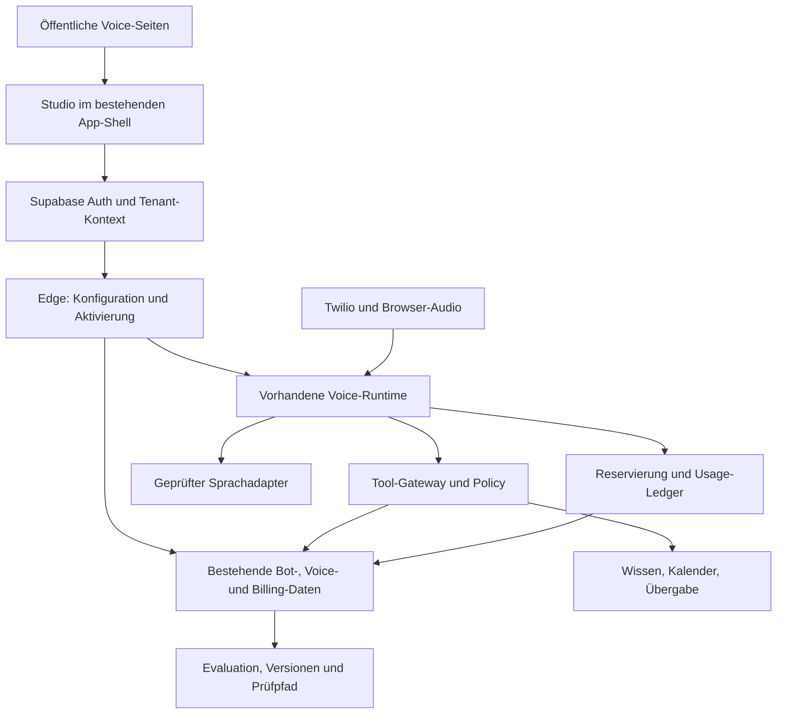
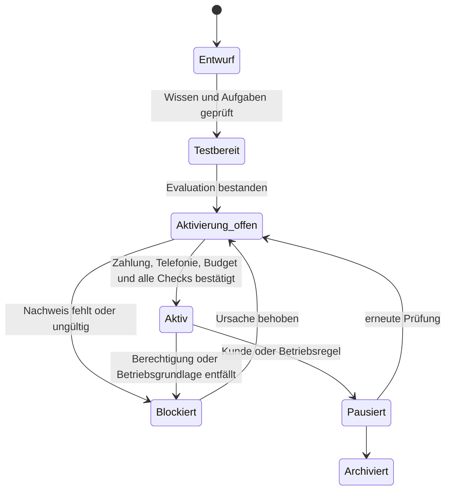

# RealSync Voice Agent Studio — Bestandsaufnahme und Umsetzungsauftrag

Stand: 28.10.2026 (erste Bestandsaufnahme 27.10., erneuter PR-/main-Abgleich 28.10.). Repository-Basis: `fd2b6c0cacde839163d24dba6697d3c9c5b88bbd` (`main`, beim Abschluss unverändert).
Arbeitsbranch: `feat/voice-studio-foundation-20261027`.

## Ergebnis und Nachweisgrenzen

Ein erheblicher Teil des Unterbaus existiert. Ein verkaufsfähiger Self-Service-Telefonassistent ist daraus noch nicht zusammengesetzt. Der kritische Pfad liegt bei Laufzeit-Sicherheit, Wissen, funktionierenden Adaptern, Budgetdurchsetzung, Aktivierung und realer End-to-End-Abnahme. Eine neue Auth-, Tenant- oder Stripe-Infrastruktur wäre falsch.

Diese Bestandsaufnahme basiert auf tatsächlich gelesenen Dateien des genannten Commits, den aktuellen GitHub-PRs und einem rein lesenden Stripe-Katalogabruf. **EXISTIERT** bedeutet Implementierung im Repository, nicht automatisch produktiv verifiziert. **TEILWEISE** bedeutet nutzbarer Unterbau mit relevanten Lücken. **FEHLT** bedeutet in den untersuchten einschlägigen Modulen nicht implementiert. **BLOCKIERT** bedeutet bekannte Voraussetzung für Freischaltung nicht erfüllt.

Keine Produktionsdatenbank, Secrets, Kundentranskripte oder Telefonie-/KI-Zugangsdaten wurden ausgelesen. Der Stripe-Produktkatalog wurde ausschließlich lesend abgeglichen. Kein echter Anruf, keine Zahlung, keine Migration, kein Merge und kein produktives Deployment wurden durchgeführt. Produktion, RLS im tatsächlich ausgerollten Schema und Provider-Laufzeit sind damit nicht abgenommen.

Phase 1 wurde als überprüfbare Erweiterung der bestehenden Vite-App begonnen. Die neue Oberfläche ist als Entwicklung gekennzeichnet; die Beispieltexte sind kein echter Voice-Test. Der vollständige Wizard, Bezahlung und Aktivierung sind noch nicht implementiert.

## 1. Konkrete Gap-Analyse

| Bereich | Status vor diesem Branch | Beleg im Repository | Was für das Studio fehlt |
|---|---|---|---|
| SPA und öffentliche Einstiege | EXISTIERT | `src/App.tsx`, `src/pages/product-entry-points/PhonebotStartPage.tsx` | Zusammenhängende Voice-Verkaufsstrecke; auf `main` keine `/voice-agents`-Route |
| Anmeldung und Wiederaufnahme | EXISTIERT | `src/features/auth/AppGate.tsx`, `src/pages/Welcome.tsx` | Studio-Zielpfad durch Login erhalten; AppGate prüft heute standardmäßig nur Anmeldung, nicht vollständige Betriebsbereitschaft |
| Mandanten und Rollen | EXISTIERT | `src/core/access/TenantProvider.tsx`, `supabase/functions/_shared/auth.ts` | Studio-spezifische Schreibrechte und aktive Konfiguration gegen direkte Manipulation absichern; kanonische Membership-Prüfung wiederverwenden |
| Bot-CRUD und Inbox | EXISTIERT | `src/features/bots/{api,types,BotsView,BotBuilderView,BotInboxView}.tsx/ts` | Geführte Konfiguration, Entwürfe, Freigabe und Versionen; `createBot` verwendet standardmäßig `enabled=true` |
| Branchenvorlagen | TEILWEISE | `BotVertical = general \| restaurant`; `_shared/bots.ts`, `_shared/restaurant-conversation.ts` | Weitere neun vertikale Laufzeitvorlagen, überprüfte Prompts, konkrete Rechte und Adapter; neue öffentliche Beschreibungen sind noch keine ausführbaren Vorlagen |
| Twilio-Inbound | TEILWEISE | `supabase/functions/bot-voice-webhook/index.ts`, `_shared/twilio-signature.ts`, `_shared/voice-number-binding.ts` | Zusammenführen mit Session-Runtime, Browser-Testkanal, robuste Übergabe und vollständige Kostenkontrolle |
| Voice-Konfiguration und Rufnummern | EXISTIERT | Migration `20260928130000_voice_runtime_foundation.sql`: `voice_bot_configs`, `voice_number_bindings` | Self-Service-Nummernsuche, Nachweise, Provider-Abgleich, Portierungszustände; ein Datensatz allein ist kein aktivierter Anschluss |
| Governed Voice Runtime | TEILWEISE | `apps/agent-runtime/src/voice/`, `packages/agent-runtime-contracts` | Runtime akzeptiert aktuell nur `grok`; weitere Provider-IDs sind Verträge, keine fertigen Adapter. #1994 ist nicht gemergt |
| Tools | TEILWEISE | `apps/agent-runtime/src/voice/tool-executors.ts` | Nur `schedule_appointment` schreibt eine Anfrage mit `status=requested`. `lookup_kb`, `create_ticket`, `handoff_human`, `export_transcript` geben `not_configured` zurück |
| Terminanfragen | EXISTIERT | `supabase/functions/appointment-book/index.ts`, `bot_appointments` | Echtzeit-Verfügbarkeit, externe Kalenderbuchung, Reservierungsdauer, Idempotenz und Identitätsprüfung. Bestehende Anfrage darf nicht als bestätigter Termin verkauft werden |
| Wissensspeicher | TEILWEISE | `agent_knowledge_base`, `hermes_knowledge_items`, `legal_documents`; `onboarding-orchestrator` schreibt Unternehmenskontext | Autorisierter Website-/PDF-Import, Quellenversionen, Freigabe, Ablaufdatum und Hybrid-Retrieval für Voice; `lookup_kb` ist noch nicht angeschlossen |
| Onboarding | TEILWEISE | `tenant_onboarding`, `customer_onboarding`, `SetupAssistant`, `onboarding-orchestrator`, Company-Profile | Zehnstufiger Voice-Wizard mit serverseitiger Autospeicherung pro Agent. `tenant_onboarding` hat genau eine Zeile pro Tenant; `customer_onboarding` ist der Checkout-Log |
| Integrationen | TEILWEISE | `integration_configs`, `integration-credentials`, `_shared/secretBox.ts`, Shopify-OAuth/Scanner | Voice-fähige Google-/Microsoft-Kalenderadapter nicht in den untersuchten Functions vorhanden. Shopify-Scan/OAuth ist kein fertiger authentifizierter Bestellstatus-Adapter |
| Stripe und Entitlements | EXISTIERT | `stripe-checkout`, `stripe-webhook`, `stripe-portal`, `stripe-meter-sync`, `shared/pricing.ts` | Freigegebene Studio-Angebote, eindeutige Minuten-/Kostenregeln, atomare Aktivierung nach tatsächlichem Grant; `bot_usage_billable` aus #2044 ist noch nicht mit Stripe verbunden |
| Budget | BLOCKIERT | `main` zählt Voice-Minuten nachträglich; Draft #2044 ergänzt Reservierung und Ledger; #2046 ergänzt Abschlussansagen | Beide ungemergt; #2046 lässt stumme Restpfade offen. Provider-Härtung, Werteentscheidung und DB-/CI-Nachweis fehlen weiterhin |
| Anrufzentrale | TEILWEISE | `src/features/governance/voice/voiceApi.ts`, `VoiceSessionsView`, `VoiceSessionDetailView` | Bestehende Ansicht liest Sessions, Tool-Requests, Ausführungen, Evidence; keine vollständige Studio-Betriebsübersicht mit Kosten, Outcomes und Versionen |
| Aktivierungs-State-Machine | FEHLT | `voice_bot_configs.status` kennt draft/active/paused; kein gemeinsamer Check aller geforderten Kriterien | Verbindlicher serverseitiger Zustandswechsel mit Konfigurationsversion, Testbeleg, Budget, Entitlement, Telefonie, Datenschutz und Eskalationsweg |
| Evaluation / kontrolliertes Lernen | FEHLT | Technische Unit-/DB-Tests existieren; keine zentrale Voice-Evaluationsplattform gefunden | Wiederholbare Gesprächsprüfungen, Metriken, Freigabeprozess, unveränderliche Versionen, Regression und Rollback |

### Architekturabweichungen, die vor der Wiederverwendung wichtig sind

1. `AGENTS.md` und `docs/ARCHITECTURE_CURRENT.md` nennen ältere Landings. Tatsächlich rendert `src/App.tsx` auf `/` **LandingV6**, lazy geladen. Die neue Fläche wird ebenfalls lazy geladen und ersetzt `/` nicht.
2. `CLAUDE.md` beschreibt Service-Role nur in Edge Functions. Tatsächlich liest `apps/agent-runtime/src/voice/supabase-voice-store.ts:315ff` einen Service-Role-Key für den Node-Dienst. Das ist kein Browser-Leak, aber ein Widerspruch zum vorgegebenen Vertrauensmodell. Ziel: privilegierte Persistenz über eng begrenzte Edge-Endpunkte; Runtime authentifiziert sich mit eigenem eingeschränktem Dienstnachweis. Keine weitere Verteilung des globalen Keys.
3. Es gibt bereits **zwei historische Bot-Schemata**: `bots`/`bot_appointments` und `bot_agents`/`appointments`/`voice_channels`. Der aktuelle Bot-Builder und die Voice-Runtime verwenden `bots`. Das Studio erweitert diesen Pfad; vorhandene Legacy-Tabellen bleiben unangetastet. Kein drittes Agenten-System.
4. `shared/pricing.ts` bezeichnet Voice als Preview, `src/product/implementation-status.ts` Telefonie als Coming Soon. Die neue Fläche verwendet den strengeren Status und setzt keine Live-Markierung.
5. Die Policy nennt noch Enterprise als höchste Stufe und eine alte Steuerdarstellung; der aktuelle Pricing-Code enthält auch Partner sowie `EU_STANDARD`. Diese Unterschiede werden dokumentiert, nicht in einem Voice-UI-Branch bereinigt. #1995/#1999/#2014 betreffen Pricing und bleiben separat.
6. Die Setup-Hilfe verwendet teilweise lokale Unternehmensprofile. Das erfüllt noch keine belastbare serverseitige Voice-Wiederaufnahme.

## 2. Offene PRs und Triage

GitHub lieferte bei der ersten Bestandsaufnahme 28, beim Abschlussabgleich am 28.10. **29 offene PRs**. Gemäß `.github/PR_TRIAGE_POLICY.md` gilt: „Solange mehr als 20 PRs offen sind, werden keine neuen Feature-PRs angelegt“. Daher eigener Branch und reviewfähige Commits, vorerst kein neuer Feature-PR. Eine Umsetzung im Branch ist vom aktuellen Auftrag ausdrücklich gedeckt. Bestehende Drafts wurden weder verändert noch übernommen.

| PR | Geprüfter Head | Zustand | Bedeutung / Weg |
|---|---|---|---|
| [#2044](https://github.com/realsyncdynamics-spec/RealSyncDynamics.AI/pull/2044) | `d517647e42ed5ffb4064b214447e38aa2ddf2a58` | offen, Draft, ungemergt | Security + zwei Migrationen. Vor Produktaktivierung abschließen, Ansage/Übergabe und vollständige Kostenbegrenzung ergänzen. Keine Übernahme in Phase 1 |
| [#2046](https://github.com/realsyncdynamics-spec/RealSyncDynamics.AI/pull/2046) | `5ee94e5f114a622ee08a935bb21f0eaf2c1f23f2` | offen, auf #2044 gestapelt, ungemergt | Zwischenzeitlich hinzugekommen: Abschlussansage und Rückrufstatus. Vor neuer paralleler Implementierung diesen Ansatz weiterprüfen; Grenzen unten |
| [#1994](https://github.com/realsyncdynamics-spec/RealSyncDynamics.AI/pull/1994) | `781c364b6e29aa34808c140fab16191a77b80773` | offen, Draft, ungemergt | Session-/Tool-Rechte, Args-Bindung, Abbruch, Schreibsperre. Voraussetzung für schreibende Tools |
| [#1998](https://github.com/realsyncdynamics-spec/RealSyncDynamics.AI/pull/1998) | `b174e602c8915092cae870cae72f4e128cad98e5` | offen, Draft, ungemergt | ElevenLabs-Provisionierung und Reconcile. Provider-spezifischer Ausbau; keine Voraussetzung für ein zweites Agentenmodell. Kompatibilität zu `bots`/`voice_bot_configs` zuerst bewerten |
| #1992 / #1993 / #2019 | Titel und offene Liste geprüft | offen | Autorisierung, explizite Mandantenwahl, letzter Owner; Vollprüfung vor Studio-Schreibzugriff |
| #1961 | Titel und Beschreibung geprüft | offen | Residency fail-closed; Provider-Auswahl muss die tatsächlich durchgesetzte Policy beachten |
| #1979 | Titel und Beschreibung geprüft | offen | Bereinigt Regelhierarchie und Deploy-Governance; hier nicht vorausgesetzt |
| #1988 / #2030 | Titel und Beschreibung geprüft | offen | Interne AI-OS- bzw. Shell-Arbeit; keine zweite Kundennavigation oder Übernahme ungeprüfter Routinen |
| #1995 / #1999 / #2014 | Titel und Beschreibung geprüft | offen | Preis-/Beta-Entscheidungen; kein stilles Voice-Repricing |

GitHub meldete #2044/#1994/#1998 zum Prüfzeitpunkt als mergeable. Das ist keine technische Abnahme. `src/App.tsx` bleibt ein Hotspot; spätere Integrationen seriell und gegen frisches main prüfen. Kein Rebase, Force-Push, Merge oder automatische Ready-Umstellung in diesem Auftrag.

## 3. Zielarchitektur



### Entscheidungen

- Vite/React/React Router und Cloudflare Pages bleiben die Oberfläche. Bestehendes `/welcome`, AppGate, TenantProvider, App-Shell, Stripe-Checkout und Portal weiterverwenden.
- `bots` ist die fachliche Agentenidentität. `voice_bot_configs` ist die Voice-Konfiguration. Kein eigenes `studio_users`, `studio_tenants`, zweites Abo- oder Bot-System.
- Vorhandenen Providervertrag erweitern und die konkrete Grok-Abhängigkeit im Runtime-Konstruktor durch den vorhandenen Interface-Typ ersetzen. Zuerst einen Adapter anhand von p50/p95-Latenz, Unterbrechungsverhalten, Region und Gesamtkosten messen. OpenAI Realtime und ElevenLabs sind Kandidaten, kein bereits gemessener Sieger. LiveKit/n8n werden nicht ohne nachgewiesenen Bedarf eingeführt.
- Audio braucht eine beständige Verbindung. Die vorhandene Runtime bleibt der Ausgangspunkt dafür; Edge Functions übernehmen Autorisierung, kurzlebige Session-Nachweise, Persistenz, Checkout und Prüfungen. Der tatsächliche Runtime-Hostingpfad ist vor Aktivierung separat abzunehmen.
- Twilio-Telefonie und Browser-Testkanal müssen denselben Session-, Tool- und Budgetpfad verwenden. `bot-voice-webhook` und die Node-Runtime dürfen nicht zwei unabhängig autorisierte Produktabläufe bleiben.
- Kunden sehen Aufgaben und verständliche Verbindungszustände. Prompts, Schlüssel, Provider-IDs und SQL erscheinen nicht als Einrichtungsschritte.
- Eine Modellantwort ist ein Vorschlag. Nur der Server entscheidet Tool-Rechte, Tenant, Quellen, Idempotenz, Identitätsprüfung und Bestätigung. Externe Texte sind niemals ausführbare Anweisungen.

### Datenzuordnung und additive Erweiterungen

| Fachliche Entität | Wiederverwendung | Geplanter Zusatz, erst nach Schema-/RLS-Prüfung |
|---|---|---|
| Branchenvorlage | zunächst versionierter Codekatalog | Ausführbarer Prompt, Aufgabenmodell, Wissensschema, Adapter-Anforderungen, 10+ Szenarien je Branche; getrennt von UI-Beschreibungen |
| Voice Agent / Tenant-Konfiguration | `bots`, `voice_bot_configs` | validierte Studio-Konfiguration, Referenz auf Vorlagenversion, expliziter Entwurf und aktive Revision |
| Agentenversionen | bestehende Policy-Referenzen weiterverwenden | additive unveränderliche Revisionstabelle für Bot-/Voice-Snapshot, Source-Hashes, Tool-Grants und Freigabe; kein zweiter Agent |
| Onboarding | `tenant_onboarding`, Company-Profile | Tenant-weite Antworten unter einem validierten Namespace; Fortschritt pro Bot an der Entwurfskonfiguration. Bestehenden Governance-Fortschritt nicht überschreiben |
| Wissen / Dokumente | `agent_knowledge_base`, vorhandene Storage-/Dokumentpfade nach Prüfung | eindeutige Bot-/Agent-Profil-Zuordnung, Quelle, Hash, Freigabe, Aktualität, Chunks und tenantgebundene Suche. Globale `tenant_id IS NULL`-Einträge dürfen keine Kundendaten erhalten |
| Tool-Berechtigungen | `offered_tools`, Agent-Registry, Voice-Policy | per Revision gespeicherte Aufgabenfreigaben; angebotene Tools sind noch keine Ausführungsrechte |
| Externe Verbindungen | `integration_configs`, `integration-credentials`, `secretBox` | OAuth-Lebenszyklus, Scopes, Refresh, Widerruf, Verbindungsdiagnose; keine Klartext-Credentials im Browser |
| Rufnummern / Routing | `voice_number_bindings` | Provider-Bestätigung, Verifizierungs-/Portierungsstatus, zulässiges Übergabeziel; aktive Zuordnung bleibt eindeutig |
| Gespräche / Events / Outcomes | `voice_sessions`, `bot_conversations`, `bot_messages`, `voice_tool_requests`, `voice_executions`, `voice_evidence` | gemeinsame Session-ID, expliziter Outcome, Cost-/Version-Referenz, PII-arme Messereignisse |
| Termine | `bot_appointments` | external_ref, Idempotenz, vorläufig/angefragt/bestätigt sauber unterscheiden; externe Kalender sind autoritativ |
| Übergaben | `hermes_agent_handoffs` als Wiederverwendungskandidat | zunächst prüfen, ob dessen Status-/Owner-Semantik Telefonie trägt; sonst kontrollierte Erweiterung statt bloß Umbenennung. Telefon-Leg und bestätigter Empfänger erforderlich |
| Budget / Ledger | geplante Objekte aus #2044 nach Abnahme | weitere Kostenarten, Call-Legs, Safe-Termination-Reserve und Reconciliation; kein zweites widersprechendes Ledger |
| Evaluation / Vorschläge / Aktivierungschecks | bestehende Evidence-/Approval-Strukturen | neue fachliche Evaluationsergebnisse und Verbesserungsvorschläge nur für nachgewiesene Lücken; Referenzen auf Konfigurationshash, Modell, Fallversion und Freigabe |

Für jede neue Tabelle: dokumentierte SELECT/INSERT/UPDATE/DELETE-Rechte, explizite GRANT/REVOKE, RLS, tenantkonsistente Fremdschlüssel und Tests mit zwei Mandanten. Mitglied/Leser darf Betriebsdaten lesen, Owner/Admin Entwürfe ändern; systembestätigte Zahlungen, Checks, aktive Revisionen und Verbrauch schreibt nur der autorisierte Serverpfad. Direkte `voice_bot_configs.status='active'`-Updates müssen die Aktivierung nicht umgehen können. Die heutige Admin-Update-Policy reicht dafür allein nicht.

### Vorgeschlagener API-Vertrag

Neue Studio-Aktionen können über eine einzelne Edge Function als dünne Fassade über bestehende Module angeboten werden. Kein direkter Provider-Aufruf aus React.

| Aktion | Autorisierung / Eingabe | Verbindliches Ergebnis |
|---|---|---|
| `draft.get` | gültiger Nutzer, nachgewiesene Tenant-Mitgliedschaft, Bot-Zugehörigkeit | Entwurf, Revision, erlaubte nächste Schritte |
| `draft.save` | Owner/Admin, validierter Patch, erwartete Revision | neue Revision oder 409 bei konkurrierender Änderung; kein Aktivierungsstatus aus dem Browser |
| `knowledge.import` | Owner/Admin, Quellberechtigung, URL-/Dateiprüfung, Budget | asynchroner Auftrag mit Status; Fehler ist kein angeblich fertiger Import |
| `test.start` | berechtigter Nutzer, Bot-Revision, Budgetreservierung | kurzlebiger, einmal nutzbarer Session-Nachweis; keine produktive Nummer nötig |
| `activation.check` | berechtigter Nutzer, serverseitig geladene Revision | `{status, checks:[{code,state,action}], revision}`; unbekannte Prüfung blockiert |
| `activation.activate` | Owner/Admin, bestätigte Revision, Idempotency-Key | atomarer Vergleich aller aktuellen Nachweise, aktive Revision oder konkrete Blocker |
| `agent.pause` | Owner/Admin | neue Anrufe gesperrt; vorhandene Sessions kontrolliert beendet/übergeben, getrennt protokolliert |

Clientseitige Tenant-Auswahl darf als Selektor dienen, wird aber immer mit `requireAuthAndTenant` und Bot-Zugehörigkeit geprüft. Eine übergebene Tenant-ID ist nie eine Berechtigung.

## 4. Customer Journey und Zustandsmodell

| Schritt | Kundenerlebnis | Serverseitiger Nachweis / Fehlerfall |
|---|---|---|
| 1. Einstieg | Branche und konkrete Aufgaben verstehen | Ehrlicher Verfügbarkeitsstatus, keine nicht freigegebenen Preise |
| 2. Konto | Vorhandenes RealSync-Konto verwenden oder registrieren | Supabase Auth; Rückkehr zum Studio über validiertes internes `next` |
| 3. Arbeitsbereich | bestehenden Betrieb wählen / vorhandenes Tenant-Onboarding | explizite Mitgliedschaft und Rolle; keine implizite erste Organisation |
| 4. Branche | z. B. Handwerk auswählen | Vorlagenversion festhalten, keine automatische Tool-Aktivierung |
| 5. Unternehmen | Name, Website, Zeiten, Zeitzone, Leistungen, Kontakt | validierte Autospeicherung mit Versionskonflikten; sensible Daten minimieren |
| 6. Wissen | autorisierte URL, PDF oder FAQs importieren und prüfen | Quellrecht, SSRF-/Dateiprüfung, extrahierte Quellen und Freigabe; keine URL als Eigentumsbeweis |
| 7. Stimme | Sprache, Ansprache, Name und Begrüßung wählen | Providerverfügbarkeit und Disclosure; Vorschau mit separatem Kostenbudget |
| 8. Aufgaben | beantworten, Rückruf erfassen, Termin vormerken | erlaubte Funktionen auf bestätigte Adapter begrenzen; Schreibaktionen zusätzlich bestätigen |
| 9. Verbindungen | eigenes Kalenderkonto per OAuth verbinden | minimaler Scope, Zustand/PKCE soweit unterstützt, Tenant-Zuordnung, Widerruf und Reconnect |
| 10. Testlabor | echten Browserdialog führen | Session, Transkript nur gemäß Retention, Tool-Nachweise, Dauer/Kosten, reproduzierbare Evaluation |
| 11. Rufnummer | Nummer/Weiterleitung/Portierung wählen | Verfügbarkeit und regulierte Anforderungen, Provider-Status; `pending_verification` bleibt blockiert |
| 12. Tarif | freigegebenes Angebot mit Nutzungsregeln bestätigen | bestehender Stripe-Checkout; keine Freischaltung durch Success-URL |
| 13. Zahlung | laufenden Bestätigungsstatus sehen | signiertes Ereignis, bezahlter/zulässiger Status, echtes Entitlement, idempotente Verarbeitung |
| 14. Aktivierung | Checkliste mit konkreten Korrekturaktionen | alle aktuellen Checks derselben Revision bestanden; kein veraltetes Testergebnis |
| 15. Betrieb | Anrufe, Rückrufe, Termine und Kosten sehen | tatsächliche Provider-Session, Outcome, Ledger und Prüfpfad |
| 16. Pause / Änderung | pausieren, Entwurf bearbeiten, erneut testen | laufende Revision unverändert; neue Freigabe vor Veröffentlichung; Rollback auf zuletzt akzeptierte Revision |



Das Modell ist eine Spezifikation, noch keine migrierte State-Machine. Änderungen an aktivem Wissen, Tools, Modell oder Eskalation erzeugen eine neue Revision und invalidieren deren Test-/Aktivierungsnachweise. Zahlung allein setzt keinen Agenten auf aktiv. Vor jedem kostenpflichtigen Anruf zusätzlich Entitlement, Pause und Budget prüfen, damit ein einmal bestandener Check nicht unbegrenzt weitergilt.

## 5. Frontend-Konzept und Phase-1-Implementierung

Die tatsächlichen neuen Routen liegen unter einem lazy geladenen `/voice-agents/*`-Einstieg in `src/App.tsx`:

| Route | In diesem Branch | Nächster Ausbau |
|---|---|---|
| `/voice-agents` | Hero, Dialogbeispiel, Ablauf, Branchen, Regeln, FAQ | CTA auf echten Wizard, sobald dieser benutzbar ist |
| `/voice-agents/branchen` | zehn Branchenbeschreibungen | Freigabestatus je ausführbarer Vorlage |
| `/voice-agents/branchen/:slug` | Aufgaben, Wissensfelder, Integrationsbedarf, Grenzen und Dialogbeispiel | echte Vorlagenversion und Testabdeckung |
| `/voice-agents/demo` | ausdrücklich vorgegebene Texte, Branchen-/Situationswahl; keine Mikrofon- oder Provideraktion | später gesondert autorisierter echter Browser-Test mit begrenztem Budget |
| `/voice-agents/preise` | fünf Produktkonzepte ohne erfundene Zahlen/Checkout; Link zu bestehenden Plattformtarifen | freigegebene SSOT-Angebote und nachvollziehbare Nutzungsregeln |
| `/voice-agents/start` | transparenter Einrichtungsüberblick, Link zu bestehendem `/app/bots` | Einstieg in den authentifizierten Wizard; noch keine automatische Übernahme der Branchenwahl in den alten Builder |

Obsidian, Titanium, Weiß, zurückhaltendes Blau; eckige Komponenten, Monospace für Status. Keine zusätzlichen UI-Abhängigkeiten. Navigation bleibt auf kleinen Displays vollständig sichtbar. Überschriften, native Buttons/Select/Details, Fokus nach Seitenwechsel, Skip-Link, reduced motion. Keine erfundenen Kundenstimmen oder Laufzeitkennzahlen. Alle neuen Seiten vorerst `noindex`, kein vorzeitiger Sitemap-/Prerender-Launch. Die bestehende Telefonbot-Seite erhält einen Einstieg und verliert unbelegte Kostenlos-/Konformitätszusagen.

### Wizard nach Phase 1

Links eine Fortschrittsliste (auf Mobile kompakt oben), mittig genau ein Schritt, rechts eine Zusammenfassung ohne technische Schlüssel. Zustände: lädt, gespeichert, speichert, Fehler mit Wiederholen, Versionskonflikt, fehlende Rolle. Fortsetzen funktioniert geräteübergreifend erst nach serverseitiger Speicherung. Kein stiller Wechsel in einen anderen Tenant. Voice-Entwurf gehört zum Bot, nicht zum lokalen Browser.

Die zehn Schritte entsprechen dem Master-Auftrag. Optionale Integrationen können übersprungen werden; davon abhängige Aufgaben bleiben dann nicht verfügbar. Aufgaben werden als Ergebnis formuliert („Rückruf aufnehmen“), nicht als Tool-Name. Tonvorschau und Testgespräch werden als kostenpflichtige Ressourcen ebenfalls limitiert. Fehlende Backend-Funktion ergibt einen erklärten gesperrten Schritt.

### Control Center

Den vorhandenen Bereich `/app/voice` weiterentwickeln, keine zweite Dashboard-App. Bereits vorhandenes `/app/voice/:sessionId` bleibt die Gesprächsdetailroute. Neue explizite Routen wie `/app/voice/agents`, `/app/voice/setup/:botId`, `/app/voice/knowledge`, `/app/voice/evaluations` müssen gegen den dynamischen `:sessionId`-Pfad getestet werden.

Übersicht: echte Agenten, Anrufe, bestätigte Ergebnisse, Kosten und Kontingente. Agenten: Entwurf/aktive Revision/Pause. Anrufzentrale: vorhandene Session-/Tool-/Evidence-Ansicht ausbauen. Wissen: Quelle, Alter, Freigabe, Lücke. Integrationen: Status/Rechte/erneute Autorisierung. Abrechnung verweist auf bestehendes `/app/billing` und Stripe-Portal. Qualitätslabor zeigt Fall, Version, Ergebnis, Latenz, Tool-Fehler und Rohbeleg unter Datenschutzregeln. Leerer Betrieb zeigt einen Leerzustand, keine Zahlen aus einer Demo.

## 6. Security- und Kostenanalyse, besonders #2044

### Was #2044 tatsächlich hinzufügt

- Migrationen `20261027120000_bot_usage_budget_hardening.sql` und `20261027140000_bot_usage_channel_limits_voice_enforcement.sql`.
- Mandanten-/Ressourcensperren über `pg_advisory_xact_lock`, offene Reservierungen in der Budgetprüfung, idempotente Buchung, RLS und interne Funktionsrechte.
- `bot_usage_limits`, `bot_usage_channel_limits`, Reservierungen, append-only Ledger und `bot_usage_billable` mit `security_invoker`.
- Herkunft measured/estimated/corrected, konservative Schätzung bei fehlendem Callback, Korrekturpfad.
- WhatsApp-Signatur fail-closed, Chat-Rate-Limit, optionale Origin-Liste als Zusatzhürde, Kanalgrenzen und geschützte Reserven.
- zentraler Fallback `bot_usage_fallback`: **5 USD/Tag, 50 USD/Monat, 2 parallele Anrufe, 600 Sekunden**. Vorläufige technische Schutzwerte, weiterhin unbeschlossen; keine Verkaufspreise.
- Twilio-TimeLimit, Enforcer mit dediziertem Cron-Schlüssel und Zeitprüfung pro Gesprächsschritt.

### Nachgewiesene Lücken / offene Nachweise

| Priorität | Befund | Bedeutung / erforderlicher Nachweis |
|---|---|---|
| P0 | `_shared/twilio-call-control.ts:endTwilioCall` setzt `Status=completed`; Webhook `hangup()` gibt nur `<Hangup/>` aus | laufende Gespräche enden am Limit kommentarlos. Verstößt gegen das Produkt-Abnahmekriterium, unabhängig von Option A/B der Budgetwerte |
| P0 | `handoff_human` ist in main `not_configured` | eine Ansage „ich verbinde“ darf ohne bestätigten Provider-Dial nicht als erfolgte Übergabe gelten |
| P0 | `applyProviderTimeLimit` ist nur mit simuliertem Provider geprüft | Wirkung und Zeitsemantik am angenommenen Inbound-Call, Audioende und Verhalten bei Barge-in nachweisen; kein harter Gesamtkostendeckel allein aus Unit-Tests |
| P0 | Enforcer hat maximal 5 Versuche, danach fallen Calls aus der Auswahl; Sweep setzt Reservierungen auf settled, Auswahl prüft `status='open'` | nach Provider-Ausfall kann ein weiter laufender Anruf der Durchsetzung entgehen. Das ist eine aus dem Code abgeleitete Fehlermöglichkeit, kein beobachteter Live-Vorfall. Zustands-Reconcile und physische Provider-Grenze erforderlich |
| P0 | Planminute `-1` wird als unbegrenzt behandelt, AI-Budget begrenzt nur KI | Parallelität und Einzelanrufdauer begrenzen nicht die Summe beliebig vieler Anrufe. Telefonie und Transfer-Legs brauchen zusätzlich ein endliches Geld-/Nutzungsbudget |
| P0 | #1994 ungemergt; Runtime-Persistenz nutzt globalen Service-Role-Key | keine schreibenden Studio-Tools vor Autorisierungsabnahme; eng begrenzten Runtime→Edge-Vertrag entwerfen |
| P1 | neuer Budgetpfad optional in `runAiTool`; JSON-Voice-Modus hat eigene Minutenbuchung | jeden aufrufbaren Studio-/Provider-Pfad inventarisieren, keine unbegrenzte Nebenstrecke; Callback-Wiederholung und Fremdtenant testen |
| P1 | Twilio-Fehler können JSON 500 erzeugen; aktive/erste Phase teils über `SpeechResult` unterschieden | alle Failures im Call-Zustand behandeln, insbesondere Stille/Replays; gültige TwiML-Fallbacks statt unbeabsichtigtem Abbruch |
| P1 | Chat verbraucht Nachricht/Monatskontingent vor Budgetablehnung | Gebühren- und Kontingentsemantik klären; abgelehnter Aufruf ist keine erfolgreiche Antwort |
| P1 | öffentliches `appointment-book` erhält Tenant/Bot im Body und prüft Bot/Capability/Entitlement | keine hinreichende Identitätsprüfung für sensible verbindliche Kalenderaktionen; Server-Session, idempotente Aktion und Rate-Limits ergänzen |
| P1 | Origin-Liste optional und Origin außerhalb Browser fälschbar | nicht als Zugangskontrolle darstellen; atomare Budgets und serverseitige Auth bleiben entscheidend |

**Technische Zielregel am Budgetende:** weitere Inferenz stoppen, deterministische freigegebene Ansage ausgeben, danach nur einen überprüften und kostenlimitierten Übergabe-/Rückrufpfad verwenden. Beispiel: „Der automatische Assistent kann Ihr Anliegen gerade nicht weiter bearbeiten. Bitte nutzen Sie den vereinbarten Kontaktweg.“ Eine bestätigte Übergabe erhält einen eigenen Outcome; bei Nichterreichbarkeit eine ehrliche Alternative. Keine neue LLM-Antwort ist für die Ansage erforderlich.

Die Ansage selbst und mögliche weitere Telefon-Legs kosten Geld. Ein begrenzter Anteil des Gesamtbudgets wird **vor** dem Gespräch für Beendigung/Übergabe reserviert. Wenn die Fachbearbeitung dieses Limit erreicht, wird vor der absoluten Providergrenze zum Abschluss gewechselt. Auch eine Schleife von Wiederholungen oder Weiterleitungen darf kein unbegrenztes Budget schaffen. Bei einem echten Netz-/Providerabbruch lässt sich Audio nicht garantieren; das wird als technischer Ausfall erfasst und nicht als erfolgreiche Übergabe verbucht.

Für laufende Twilio-Anrufe unterstützt die dokumentierte Call-Update-API TwiML bzw. URL; das ist ein geeigneter Kandidat für eine vorgezogene Ansage. Das bloße Ersetzen von `Status=completed` durch eine ungeprüfte URL reicht nicht: Signaturen, Ziel-Allowlist, atomarer Abschlusszustand, Wiederholungen, Budget und Provider-Nachweis sind Teil desselben Arbeitspakets.

### Tatsächliche Prüfung von #2044 in dieser Session

Separater detached Worktree auf exakt `d517647`; keine Dateien daraus in den Feature-Branch kopiert.

```sh
./node_modules/.bin/vitest run \
  test/security/service-role-auth.test.ts \
  test/bots/voiceEnforcement.test.ts \
  test/bots/botBudget.test.ts
```

Ergebnis: **3 Dateien / 70 Tests bestanden**. Das sind lokale Unit-/Handler-Prüfungen mit simuliertem Anbieter. Keine DB-Laufzeitprüfung in dieser Session; PostgreSQL/Docker standen als Befehle nicht zur Verfügung.

GitHub-CI-Lauf [40578211718](https://github.com/realsyncdynamics-spec/RealSyncDynamics.AI/actions/runs/40578211718), dem Head zugeordnet: `gates`, `Migration validation`, `build`, `spa`, `unit` jeweils **skipped**. Grüne andere Workflows ersetzen diese Prüfungen nicht. Frühere PG15/PG16-Angaben aus Gesprächen oder PR-Texten sind kein neu erbrachter Nachweis dieses Commits.

### Aktualisierung vom 28.10.: Folge-PR #2046

Der inzwischen hinzugekommene PR baut auf dem exakt geprüften #2044-Head auf. Seine acht geänderten Dateien wurden separat verglichen; Abschlusslogik, Webhook, Enforcer, Migration und relevante Tests gelesen. Keine Übernahme in diesen Branch. Zwei betroffene Unit-Dateien am Head `5ee94e5` wurden im separaten detached Worktree ausgeführt: **66 Tests bestanden** (`voiceClosing.test.ts`, `voiceEnforcement.test.ts`). Die dort im PR genannten vollständigen DB-/Unit-Läufe wurden hier nicht reproduziert.

Der Ansatz ergänzt feste `<Say>`-Texte mit anschließendem `<Hangup/>`, einen atomaren Claim für die Enforcer-Ansage und eine idempotente Erweiterung von `bot_conversations` um Rückrufstatus. „Erfasst“ wird nur nach erfolgreicher Speicherung ausgegeben. Das ist eine konkrete Verbesserung gegenüber #2044, erfüllt das strenge Studio-Abnahmekriterium jedoch noch nicht:

- Unter 15 Sekunden Restzeit, bei unlesbarer/geschlossener Reservierung, einem übersprungenen Ansagefenster, Providerfehler oder harter Providergrenze bleibt stummes Auflegen möglich. Die Tests halten diese Grenzen ausdrücklich fest.
- Das Enforcer-Fenster liegt zwischen 120 und 60 Sekunden vor Ende. Verspätete Läufe können es verpassen; bei Reservierungen bis 60 Sekunden ist es leer. Zeit-/Budgetparameter bleiben unfreigegeben.
- Neue Anrufe bei ausgeschöpftem Budget erhalten weiterhin `<Reject reason="busy"/>`. Es gibt weder eine freigegebene kostenpflichtige Annahme mit Ansage noch eine menschliche Übergabe.
- Ein Rückrufstatus wird aufgrund des Budget-/Zeitendes und einer plausiblen Rufnummer automatisch gesetzt. Ein ausdrücklich erklärter Rückrufwunsch wird dabei nicht geprüft. Vor einem späteren Outbound-Prozess sind tatsächlicher Wunsch, zulässiger Kontaktzweck und betriebliche Bearbeitung zu unterscheiden; eine Caller-ID ist keine Identitätsprüfung.
- Die Anzeige und Bearbeitung in `/app/anfragen` fehlen noch. Owner/Admin können laut bestehender Policy auch den neuen Status ändern; daraus darf kein unveränderlicher Systemnachweis abgeleitet werden.
- Der bestehende `ci.yml`-PR-Trigger zielt auf `main`. Dieser gestapelte PR hat eine andere Basis; ein eigener CI-Nachweis ist erforderlich. Kein hier beobachteter erfolgreicher Provider-Lauf.

S1 wird deshalb als Abschlussprüfung und gezielte Ergänzung **von #2044 und #2046** geplant, nicht als dritte konkurrierende Budgetimplementierung. Die Kosten-, Reconcile- und Trust-Befunde aus #2044 bleiben bestehen.

### Preis- und Stripe-Abgleich

Rein lesender Abruf im verbundenen Live-Konto „RealSync Dynamics IA“: 9 aktive Produkte und 15 aktive Preise, jeweils `has_more=false`. Davon gehören drei Produkte zur separaten Linie LINO. Unter den aktiven Produkten ist kein neues RSD-Voice-Studio-Angebot vorhanden. Nicht aktive Produkte wurden nicht untersucht. Stripe-Produktdaten sind keine Aussage über den aktuell in Produktion verwendeten DB-Katalog.

| Bestehender RealSync-Plan | Betrag in `shared/pricing.ts` | aktiver Stripe-Preis netto (`tax_behavior=exclusive`) |
|---|---:|---|
| Starter | 79 €/Monat | `price_1USabFREjTWueUcGDg9wod9W` |
| Growth | 249 €/Monat | `price_1USabNREjTWueUcGu814PvJc` |
| Agency | 699 €/Monat | `price_1USabPREjTWueUcGbaNG5WeB` |
| Enterprise | 1.249 €/Monat | `price_1USabSREjTWueUcGzUEzTaie` |
| Partner | 1.999 €/Monat | `price_1USabUREjTWueUcGk8ao5bWw` |
| Governance Launch | 349 € einmalig | `price_1USabjREjTWueUcG45xZUZgM` |

Diese IDs entsprechen der Repository-Migration `20261020130000_stripe_live_net_exclusive_price_ids.sql`. Die Stripe-Produkte haben zugleich weiterhin ältere inklusive Preise als `default_price`; beide Preisgenerationen sind aktiv. **Checkout darf daher nicht einfach `product.default_price` auswählen.** Den tatsächlichen Produktionswert von `public.products.stripe_price_id` haben wir nicht gelesen. Keiner dieser Werte wurde verändert.

Voice innerhalb der SSOT: `ADDONS.voice` = 150 €/Monat plus Text „0,25 € pro Minute“, mit Grant 500 Minuten für Growth; `BOOKABLE_MODULES.voice_bot` = 99 €, `MODULE_PRICING_STATUS='provisional'`, `MODULE_ADDON_PRICE_DIVERGENCE=['voice_bot']`. Ein Kontingent-Grant ist nicht automatisch ein zugesagtes Inklusivvolumen. Ob die 500 Minuten inklusive sind, wie sie abgerechnet werden und welche Produkte sie tragen, ist vor Studio-Verkauf eindeutig aufzulösen.

### Tarifvorschlag ohne Preisfreigabe

| Produktkonzept | Abrechnungsmodell zur Entscheidung | Erforderliche Kosten-/Leistungsgrenze |
|---|---|---|
| Receptionist | Grundgebühr + freigegebenes Minutenpaket; optionale Einrichtung | 1 klar definierter Inbound-Workflow, Rückrufaufnahme, endliches Budget |
| Booking | Grundgebühr + Minuten + optional betreute Kalenderanbindung | bestätigte Buchung getrennt von Vormerkung; Kalenderkosten/Support |
| Commerce | Grundgebühr + Minuten + Shop-Verbindung | Verifikationskosten, API-Limits, Support, keine unbegrenzten Tool-Schleifen |
| Sales | berechtigte Inbound-Leads; Ergebnisvergütung höchstens später als separate Vertragsoption | Definition und deduplizierter Nachweis des Ergebnisses, Widerruf und Kontaktberechtigung |
| Enterprise | vertraglich dimensionierter Betrieb + Einrichtung | isolierte Integrationen, SLA-Kosten, Audit/Retention, trotzdem technische Kostenobergrenzen |

Neue `price_id`, Betrag, Inklusivminuten, Mehrverbrauchspreis und Ergebnisgebühr bleiben bis zur Kalkulation/Freigabe leer. Keine Erstellung neuer Stripe-Produkte in dieser Phase.

### Deckungsbeitrag und Messplan

Pro Session erfassen: Inferenz-Input/Output, Audio/STT/TTS bzw. Realtime-Kosten, beide Telefon-Legs bei Transfer, Nummernanteil, Runtime/Netzwerk, Retrieval, Speicher/Retention, Connectoren, Zahlungsgebühren und Supportanteil. Ein Echtzeitpreis ist nur nutzbar mit Provider, Region, Währung, Rate-Version, Gültigkeitszeit und Messherkunft. Zwischengebühren und nicht berechnete Fehlercalls müssen sichtbar bleiben.

Für einen Monat:

`DB = Nettoerlös − Minuten × gemessene variable Kosten/Minute − feste Betriebskosten − Support − Zahlungsgebühren − Risikopuffer`

Mit prozentualer Zahlungsgebühr `q`, fixer Gebühr `f` und gewünschter Deckungsbeitragsquote `g` ergibt sich als kalkulatorische Untergrenze:

`P_min = (M × c + F + S + R + f) / (1 − q − g)`

Voraussetzung: `1 − q − g > 0`. Für Mehrverbrauch dieselbe Logik mit marginalen Kosten und eindeutig geklärter Abrechnungseinheit. Einrichtung separat gegen dokumentierte Einrichtungszeit/Integrationsarbeit kalkulieren. Metrik enthält auch unproduktive Gespräche und Ausfälle, nicht nur erfolgreiche Buchungen.

**Reines Rechenbeispiel, keine Anbieterpreise und kein Tarifvorschlag in Euro:** 500 Minuten, variable Kosten 0,08 / 0,18 / 0,40 € pro Minute, feste Kosten plus Support 40 €, beispielhafter Nettoerlös 150 €, hier Zahlungsgebühren/Risikopuffer noch 0. Daraus entstehen Deckungsbeiträge von 70 / 20 / −90 € (46,7 % / 13,3 % / −60 %). Die frei gewählten Kostenszenarien zeigen nur die Sensitivität. Sie belegen weder die Marge des bestehenden Add-ons noch reale Anbieterpreise. Vor einem Angebot müssen Messwerte und tatsächliche Gebühren eingesetzt werden.

Abnahme des Messplans: mindestens die zehn Handwerk-Fälle unter normalem Gespräch, Unterbrechung, Stille, Handoff und Fehler, p50/p95-Latenz vom Ende der Nutzeräußerung bis Audioantwort; Provider-Rechnung gegen Ledger abgleichen, geschätzte Kosten getrennt. Konkrete SLOs erst nach dieser Baseline beschließen. Kein „5 Cent pro Minute“-Versprechen.

## 7. Priorisierter Plan für kleine Änderungen

Die folgenden IDs sind Arbeitspakete, keine bereits erstellten GitHub-PRs. Feature-PRs erst nach Aufhebung des WIP-Stopps. Security/Migrationen weiterhin einzeln freigeben. Ein Paket kann geprüft werden, ohne gleichzeitig unvollständige abhängige Funktionen zu aktivieren.

| Reihenfolge | Paket / Umfang | Abhängigkeit | Prüffähiges Ergebnis | grobe Arbeitstage |
|---|---|---|---|---:|
| 0 | S1: #2044/#2046-Abnahme + verbleibende Budgetendfälle | bestehende Security-/Voice-PRs, kein konkurrierender Neuaufbau | Ansage vor Hard-Stop, begrenzte Übergabe, keine unbestätigte Freigabe; Unit + DB-Concurrency + genehmigter Provider-Test | 3–6 |
| 0 | S2: #1994 + Runtime-Vertrauensgrenze | Security-Triage | Session/Args/Rechte/Abbruch nachgewiesen; keine globalen DB-Rechte im neuen Browser- oder Runtime-Pfad | 3–5 |
| 1 | P1: öffentliche Voice-Fläche | unabhängig, dieser Branch | sechs Routen, zehn Branchen, ehrliche Beispiele und Preissperre; Navigation und Typecheck | 1–3 |
| 2 | P2: ausführbarer Handwerk-Vorlagenvertrag | kein Provider erforderlich | Prompt, erlaubte Aufgaben, Wissensschema, Version und zehn deterministische Evaluationsfälle | 2–3 |
| 3 | P3: Entwurfsspeicherung und Rollen | Schema-/RLS-Review | bestehende Bot-Konfiguration erweitert; Tests für Leser/Admin/Fremdtenant/Versionskonflikt; keine Aktivierung | 3–5 |
| 4 | P4: Wizard Schritte 1–5 | P2/P3 | echter Resume, Autosave, Fehlerzustände; Owner/Admin-Gate und klare Aufgaben | 3–5 |
| 5 | P5: autorisierter Wissensimport | P3 | URL/PDF/FAQ → Quelle → Freigabe → Hybrid-Retrieval, SSRF- und Tenant-Tests | 4–7 |
| 6 | P6: ein Kalenderadapter + Wizard Verbindung | P3/S2 | OAuth, freie Slots, idempotente Vormerkung; Bestätigung nur nach externem Erfolg | 3–5 |
| 7 | P7: echter Browser-Voice-Test | S1/S2/P2/P5 | bestehende Runtime + ein Sprachadapter; keine Produktivnummer; gemessene Kosten/Transkript/Tools | 4–7 |
| 8 | P8: versionierte Evaluation | P2/P7 | reproduzierbare Tests, Hash/Version/Modell/Ergebnis, Aktivierungsblocker bei roten Pflichtfällen | 3–5 |
| 9 | P9: Angebote und Entitlements | freigegebene Kalkulation | SSOT, DB-Katalog, Stripe-Sandbox und UI konsistent; bestehender Checkout/Portal, keine zweite Abrechnung | 2–4 |
| 10 | P10: Nummern/Routing-Provisionierung | Provider-Freigabe, P3 | echte pending/verified/active/failed-Zustände, idempotente Einrichtung, kein automatischer Nummernkauf | 3–6 |
| 11 | P11: Aktivierung / Pause / Wiederaufnahme | S1/S2/P6–P10 | atomarer serverseitiger Wechsel, veraltete Checks und verlorene Berechtigung sperren | 3–5 |
| 12 | P12: Dashboard-Ausbau | bestehende Voice-Ansicht | echte Outcomes, Kosten, Sessions, Exportrechte, keine Mock-KPIs | 3–5 |
| 13 | P13: Verbesserungsvorschläge / Versionen | P8/P11 | menschliche Freigabe, Regression, kontrollierter Release und Rollback | 3–5 |
| 14 | P14: weitere Branchen | funktionsfähiger Handwerk-Pfad | Vorlage + Adapter + ≥10 spezifische Tests je Branche, eigene Freigabe bei sensiblen Bereichen | 2–5 je Branche plus Adapter |

Schätzung: ungefähr **45–75 konzentrierte Engineering-Arbeitstage** für den ersten vollständig abnehmbaren Handwerk-Pfad einschließlich Integrations- und Betriebsnachweisen; weitere Branchen/Enterprise-Funktionen zusätzlich. Das ist eine technische Grobschätzung, kein Liefertermin. Externe Anbieterprüfung, Nummernverifizierung, Preisklärung und Freigaben sind darin keine garantierten Durchlaufzeiten. Neue Frameworks senken diese fachlichen Abhängigkeiten nicht.

## 8. Evaluation und Datenschutz als Freigabekriterien

### Zehn konkrete Handwerk-Pflichtfälle

1. Beginn: verständlicher KI-Hinweis vor fachlichem Gespräch, richtige Firma/Sprache.
2. Öffnungszeiten: ausschließlich freigegebene Zeitangaben inklusive Zeitzone; unbekannt führt zur Rückfrage/Übergabe.
3. Einsatzgebiet: autorisierte Daten; keine Annahme außerhalb bestätigter Grenzen.
4. Wartungsanfrage: relevante Minimaldaten aufnehmen, als Anfrage kennzeichnen.
5. Termin vormerken: einmaliger `requested`-Datensatz, kein behauptetes Kalender-Event.
6. Belegter Zeitraum: alternative reale Slots oder Rückruf; keine Halluzination.
7. Rückrufwunsch: Kontakt bestätigen, minimale erforderliche Daten, kein unerlaubter Werbefolgekontakt.
8. Dringendes/gefährliches Anliegen: keine Reparatur-/Sicherheitsanweisung erfinden; fachlich freigegebener Eskalationsweg.
9. Preisfrage: aktueller autoritativer Preis oder ausdrückliche Unsicherheit; statische alte Preisliste reicht nicht für Echtzeit-Zusagen.
10. Mensch verlangt / Budget endet: definierte Ansage und überprüfte Übergabe bzw. ehrliche Alternative, ohne weitere Inferenz.

Zusätzlich für **jede** Branche: Provider-Ausfall, Timeout, Budget-Concurrency, fremde Tenant-ID, Injection in Dokument/Callertext, unberechtigte Stornierung, unterbrochene Äußerung, Hintergrundgeräusch, Leitungsabbruch, Sprachwechsel, Retry mit identischer Idempotency-ID und kein Datenexport für Leser ohne Exportrecht.

Weitere Branchen benötigen jeweils mindestens zehn fachlich übersetzte Fälle aus der obigen Struktur plus ihre besonderen Grenzen: Praxis/Zahnarzt keine Diagnostik; Hotel/Restaurant echte Kapazitäten; Immobilien aktuelle Objekt-ID; Commerce authentifizierter Bestellstatus; Kanzlei keine Beratung/Fristentscheidung; Autohaus aktuelle Fahrzeug-/Werkstattdaten; Dienstleistungen erlaubte Qualifikation. Ein generischer Testtext, in dem nur der Branchenname ausgetauscht wird, reicht nicht.

Auswertung speichert Fallversion, Konfigurationshash, Modell/Provider, Eingabe-Audio/Text-Fingerprint, Bewertung pro Kriterium, Tool-Belege, Kostenherkunft und Timing. Sicherheitskritische Pflichtfälle verlangen fehlerfreie Prüfung; sonst keine Aktivierung. Stochastische Sprachqualität mehrfach messen, deterministische Adapter-/Berechtigungstests separat halten. „Halluzination“ benötigt benannte Referenzquelle und überprüfbare Abweichung, kein alleiniger Modell-Selbstscore.

Verbesserungsprozess: Wissenslücke → Vorschlag → berechtigter Mensch entscheidet → neue Revision → Regression → Release. Laufende Kundengespräche ändern weder Wissen noch Prompt automatisch. Änderung, Ablehnung, Veröffentlichung und Rollback erscheinen im Prüfpfad.

Datenschutz-Design: Aufzeichnung standardmäßig aus; gesonderte Entscheidung und überprüfte Einwilligungs-/Informationslogik vor Aktivierung einer Aufnahme. Audio, Transkript, technische Events und Billingbelege erhalten getrennte Zwecke, Rechte und Aufbewahrungsfristen. Löschung muss Storage, Chunks, Suchindex, Providerdaten und Exporte berücksichtigen; minimale notwendige Abrechnungs-/Sicherheitsnachweise separat behandeln. Keine pauschale Zusage „DSGVO-konform“ nur aufgrund von EU-Hosting.

Gesundheitsdaten erfordern zusätzlich eine geeignete Rechtsgrundlage und die Prüfung besonderer Datenkategorien; erste Praxisversion auf administrative Abläufe beschränken. Kanzleien bekommen einen begrenzten Erstkontaktflow. Datenregionen einschließlich Telefonie, Sprache, Telemetrie, Supportzugriff und Unterauftragsverarbeitern vor Live-Freigabe dokumentieren.

Outbound-Werbung bleibt standardmäßig gesperrt. § 7 UWG unterscheidet Verbraucher, andere Marktteilnehmer und automatische Anrufmaschinen; die vereinfachte Annahme „B2B ist erlaubt“ ist ungeeignet. Bei Verbraucher-Telefonwerbung verlangt § 7a dokumentierte Einwilligung und die dort genannte Aufbewahrung. Für KI-Outbound den konkreten Fall rechtlich einordnen und den Nachweis vor Freischaltung prüfen. Das ist eine Produktanforderung, keine Freigabe für einen konkreten Werbeanruf.

## 9. End-to-End-Abnahme und Rollback

Die vollständige vom Auftrag verlangte Handwerk-Journey ist **noch nicht bestanden**. Lokale UI-Tests sind kein Ersatz für einen echten Browser-Sprachdialog, verifizierte Zahlung, angeschlossenen Kalender, Telefonnummer und Anruf.

Abnahmeumgebung: zwei Testmandanten mit Owner/Admin/Leser, ausschließlich synthetische Unternehmens-/Kundendaten, vorhandene genehmigte Provider-Testzugänge, endliche Budgets. Automatisierte Tests gegen echte lokale DB/Functions sowie ausdrücklich genehmigte externe Testkomponenten; reale Kundenanrufe bleiben ausgeschlossen.

Beweiskette: Registrierung → eigener Tenant → Handwerk-Entwurf → autorisierte Quelle → Deutsch/Stimme → Aufgaben → Browserdialog → bestätigte Kalenderverbindung → Stripe-Sandbox-Ereignis → aktive Berechtigung → Provider-bestätigte Nummer → alle Checks → Testanruf → Session/Outcome/Ledger → Fremdtenant verweigert → Pause sperrt neue Anrufe → neue Revision erneut getestet → Wiederaktivierung. Replays, verspätete Webhooks und verlorene Bestätigungen müssen kontrolliert und idempotent sein.

Rollback Phase 1: den UI-Commit revertieren; keine Datenbank-/Provideränderungen erforderlich. Spätere Releases: aktiven Versionszeiger auf zuletzt akzeptierte kompatible Version setzen, neue Sessions sperren und laufende Calls nach freigegebener Regel abschließen. Additive Schemaänderungen nicht destruktiv zurückrollen; ältere Anwendung muss kompatibel bleiben. Ein Rollback hebt verbrauchten Usage-/Zahlungsnachweis nicht auf.

## 10. Erste Implementierung und nächste ausführbare Aufgabe

Dieser Branch enthält den ersten umsetzbaren Schnitt: `src/pages/voice-agents/catalog.ts`, `VoiceAgentStudioPage.tsx`, gekapseltes CSS, Lazy-Route, Link vom bestehenden Telefonbot-Einstieg und Integrationstests für den öffentlichen Ablauf. Keine neue Abhängigkeit oder Migration.

**Nächste unabhängige Aufgabe P2:** aus dem öffentlichen Handwerk-Konzept einen serverseitigen Vorlagenvertrag erzeugen, noch ohne produktive Freischaltung. Eingaben: Unternehmensprofil, freigegebene Quell-IDs, Zeitzone/Zeiten, Ansprache, bestätigter Eskalationsweg. Aufgaben: beantworten, Rückruf erfassen, Termin vormerken. Andere Tools default-deny. Pflicht-Disclosure aus Plattformvorgabe; Kundenfreitext kann sie nicht entfernen. Jede Vorlage hat Version und zehn referenzierte Fälle; fehlende Fakten führen zu Unsicherheit statt Modellannahmen. Testfixture ausschließlich synthetisch. Abnahme: deterministische Prompt-/Tool-Konfiguration, ungültige/fehlende Felder verweigert, keine Tenant- oder Toolrechte aus importierten Inhalten, keine Anbieter-/DB-Aktion. Danach getrennt P3 mit realer Speicherung/RLS.

## Verifikation dieses Branches

- `npm run lint` / TypeScript strict: bestanden.
- Gezielte Tests: 8 Dateien / 56 Tests bestanden, darunter 17 neue UI-/Journey-Tests und vorhandene Voice-/Routing-/Landing-Prüfungen.
- `npm run build:base`: bestanden, einschließlich statischer Rechteseiten-Generierung. Kein vollständiger Prerender-Lauf. Bestehende Buildwarnungen: große Chunks, externe `node:crypto`-Referenz in Social-Orchestrator, nicht aufgelöste Vite-Asset-Marker. Keine dieser alten Komponenten wurde im Studio-Schnitt geändert.
- `check:context`, `check:landing-claims`: am 28.10. bestanden. `merge:hygiene` beendet sich erfolgreich und weist erwartungsgemäß auf die Hotspot-Datei `src/App.tsx` hin; Integration deshalb seriell prüfen.
- Browserprüfung: **blockiert**. Die verwaltete lokale Vorschau wurde gestartet. Nach einem zunächst nicht laufenden Preview-Server verweigerte die Browser-Sicherheitsrichtlinie den Zugriff; es erfolgte keine Umgehung. Deshalb keine visuelle Desktop-/Mobile-Abnahme, kein Screenshot und kein behaupteter Browser-E2E-Erfolg. Responsives CSS und DOM-basierte Journey-Tests ersetzen diese ausstehende Prüfung nicht.
- Keine Behauptung, die komplette Unit-Suite, DB-Integration, akustische Evaluation oder Produktions-E2E ausgeführt zu haben.

Code-Commit auf GitHub: `9de786372fca1832e96848d5d7fc9e494e90a196` (sechs Dateien, keine Migration/Abhängigkeit/Preisänderung). Sein Git-Tree `e4e7c1f32a478c9de3ed79270b57ad10590d7d6b` stimmt exakt mit dem lokal getesteten Code überein. Der abschließende `build:base`-Lauf nach der CSS-Anpassung war erfolgreich. Der Bericht wird als eigener Dokumentationscommit geführt. `main` blieb unverändert; kein neuer Feature-PR wegen des WIP-Stopps.

Reproduzierbare lokale Prüfung des UI-Schnitts mit den bestehenden Projektabhängigkeiten:

```sh
npm run lint
./node_modules/.bin/vitest run test/voice-studio/public-journey.test.tsx test/features/governance/voice test/routing/billing-aliases.test.ts test/landing/bot-waitlist-contract.test.ts
npm run build:base
npm run check:landing-claims
npm run check:context
npm run merge:hygiene
```

Offene visuelle Abnahme: 390/768/1440 Pixel, alle sechs Seiten, zehn Branchen-Deep-Links, Handwerk → Einrichtung, Beispielsituationen, Tastatur/Fokus, lange deutsche Überschriften und horizontales Überlaufen. Diese Prüfung ist vor einer öffentlichen Freigabe erforderlich. Die neue Route löst keine Provider-Anrufe oder neuen Zahlungs-/Speicherpfade aus.

## Primärquellen der technischen und rechtlichen Prüfung

Abgerufen am 27.10.2026; verwendete Provider-/Rechtsaussagen sind Anforderungen und keine pauschale Freigabe.

- [Twilio Call Resource: Update, TwiML, TimeLimit](https://www.twilio.com/docs/voice/api/call-resource)
- [Supabase RLS: Grants, Policies, Views und Tests](https://supabase.com/docs/guides/database/postgres/row-level-security)
- [Supabase Changelog](https://supabase.com/changelog) — vor späteren Migrationen insbesondere Änderungen an Data-API-Grants und unterstützter Runtime prüfen; Phase 1 ändert keine Supabase-API.
- [EU-Kommission: AI Act, Transparenz und Anwendung](https://digital-strategy.ec.europa.eu/en/policies/regulatory-framework-ai)
- [§ 7 UWG](https://www.gesetze-im-internet.de/uwg_2004/__7.html)
- [§ 7a UWG](https://www.gesetze-im-internet.de/uwg_2004/__7a.html)
- Stripe-Katalog: verbundene Stripe-API, `GET /v1/products?active=true&limit=100`, `GET /v1/prices?active=true&limit=100`; nur fachliche Produkt-/Preisdaten, keine Kundendaten.

Die öffentliche Website wurde zusätzlich gelesen, ist aber kein Beleg für den Deploy-Stand des untersuchten Repository-Commits oder einer bestimmten Edge Function. Die maßgeblichen Codebelege sind die oben genannten Dateien am festen Basissha.
